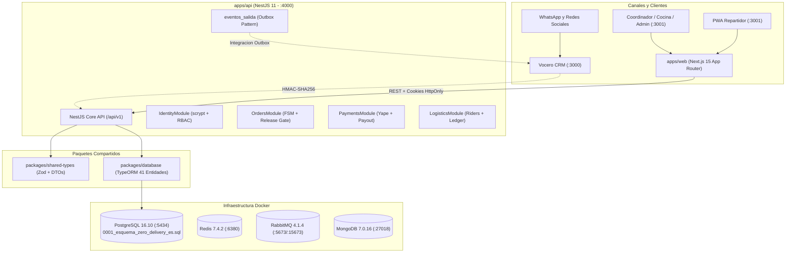

# Zero Delivery - Plataforma Operativa de Delivery Multi-Restaurante

> **Estado del Proyecto:** Hitos 0, 1 y 2 COMPLETADOS al 100% con pruebas automatizadas en vivo aprobadas.  
> **Proxima Fase:** Hito 3 (Frontend Web Next.js 15 PWA en `apps/web`).  
> **Fecha de Actualizacion:** 2026-10-26  
> **Monorepo:** pnpm workspaces (`apps/api`, `apps/web`, `packages/database`, `packages/shared-types`, `packages/config`).

---

## Tabla de Contenidos
1. [Arquitectura General](#1-arquitectura-general)
2. [Lo que ya se hizo hasta ahora (Completado)](#2-lo-que-ya-se-hizo-hasta-ahora)
   - [Hito 0: Infraestructura y Base Canonica](#hito-0-infraestructura-y-base-de-datos-canonica)
   - [Hito 1: Capa de Dominio y Modelos de Datos](#hito-1-capa-de-dominio-y-modelos-de-datos)
   - [Hito 2: Backend NestJS y Logica Central](#hito-2-backend-nestjs-y-logica-central)
   - [Resultados de las Pruebas en Caliente](#resultados-de-las-pruebas-en-caliente)
3. [Puntos de Mejora Detectados](#3-puntos-de-mejora-detectados)
4. [Resumen del Roadmap de Hitos](#4-resumen-del-roadmap-de-hitos)
5. [Guia Rapida de Ejecucion Local](#5-guia-rapida-de-ejecucion-local)
6. [Especificacion Detallada de Ejecucion para lo que Falta por Hacer (Hitos 3, 4 y 5)](#6-especificacion-detallada-de-ejecucion-para-lo-que-falta-por-hacer-hitos-3-4-y-5)
   - [Hito 3: Frontend Web Next.js 15 PWA](#hito-3-frontend-web-nextjs-15-pwa-appsweb)
   - [Hito 4: Conector Bidireccional Vocero CRM](#hito-4-conector-bidireccional-vocero-crm-appsapi-e-integracion)
   - [Hito 5: Reporteria CSV BOM, Auditoria Final y Tests E2E](#hito-5-reporteria-csv-bom-auditoria-final-y-tests-e2e-playwright)

---

## 1. Arquitectura General



---

## 2. Lo que ya se hizo hasta ahora

### Hito 0: Infraestructura y Base de Datos Canonica
- **Docker Compose Operativo y Aislado**:
  - PostgreSQL 16.10 en puerto `127.0.0.1:5434` (aislado para no colisionar con Vocero CRM en el 5432).
  - Redis 7.4.2 en puerto `127.0.0.1:6380`.
  - RabbitMQ 4.1.4 en puertos `5673` y `15673` (Panel de administracion).
  - MongoDB 7.0.16 en puerto `27018`.
- **Esquema de Base de Datos Canonico en Espanol**:
  - Se ejecuto el DDL oficial `0001_esquema_zero_delivery_es.sql`.
  - 45 tablas base creadas en espanol y 1 vista contable (`vista_saldo_garantia_repartidor`).
  - Extension `pg_trgm` instalada y activa.
  - Funcion de base de datos `siguiente_contador(inquilino_id, secuencia)` instalada para numeracion atomica.
  - **Inmutabilidad de Auditoria Verificada**: Se probo en caliente que el trigger `prohibir_mutacion()` bloquea efectivamente cualquier intento de `UPDATE` o `DELETE` sobre `registro_auditoria` lanzando la excepcion `restrict_violation`.
  - Sembrado inicial: Inquilino demo (`zero-delivery-demo`) y 18 configuraciones iniciales sembradas en `configuraciones` con sus marcadores correspondientes.

### Hito 1: Capa de Dominio y Modelos de Datos
- **`packages/shared-types` (Compilado y exportado)**:
  - `money.ts`: Operaciones monetarias exclusivamente en centimos enteros (`Cents` / `bigint`) con `formatPen()`, `centsToSoles()` y `solesToCents()`. Prohibicion estricta de numeros flotantes.
  - `phone.ts`: Normalizador estricto E.164 para numeros moviles de Peru (`+519XXXXXXXX`).
  - `time.ts`: Fechas siempre en UTC con helpers para formateo y fecha operativa en zona horaria `America/Lima`.
  - `enums.ts`: Mapeo bidireccional estricto entre identificadores logicos en ingles (`ADMIN`, `CONFIRMED`, `YAPE`, `CASH`) y valores fisicos en espanol de la BD (`ADMINISTRADOR`, `CONFIRMADO`, `YAPE`, `EFECTIVO`).
  - `permissions.ts`: Matriz canonica de los **47 permisos** con la funcion pura `can(actor, action, resource, settings)` evaluando aislamiento multi-inquilino absoluto y la regla inviolable de no mutar auditoria ni libro mayor.
  - DTOs Zod completos: Catalogo, Clientes, Pedidos (`CrearPedidoManualInput`, `CustomerOrderDTO`, `BranchManagerOrderDTO`, `StaffOrderDTO`), Pagos, Logistica y Vocero CRM (`EventoDespacho`).
- **`packages/database` (41 Entidades TypeORM Canonicas)**:
  - 41 entidades mapeando columna por columna el DDL en espanol.
  - `synchronize: false` absoluto para preservar el esquema de PostgreSQL.
  - Respeto a tablas inmutables (append-only): `registro_auditoria`, `historial_estados_pedido`, `eventos_pago`, `movimientos_billetera`.
  - Mapeo de `bigint` como cadenas (`string`) en JavaScript para evitar perdida de precision de enteros de 64 bits.
  - Control de version optimista (`@VersionColumn()`) en `PedidoEntity`.
  - Verificacion en caliente con script de prueba inicializando `AppDataSource` contra el PostgreSQL real.

### Hito 2: Backend NestJS y Logica Central
Implementado integramente en `apps/api`:
- **Modulo de Identidad y Autenticacion (`IdentityModule`)**:
  - `ScryptService`: Hashing criptografico nativo con `scrypt` ($N=16384, r=8, p=1$), salt aleatorio de 16 bytes y verificacion en tiempo constante (`timingSafeEqual`) contra ataques de temporizacion.
  - `AuthService`:
    - Login por `slug` de inquilino + `nombre_usuario` + contrasena contra `hash_contrasena` (protegida con `select: false`).
    - **Proteccion Anti-Fuerza Bruta**: 5 intentos fallidos activan un bloqueo estricto de 15 minutos en `usuarios.bloqueado_hasta`.
    - **Sesiones Seguras**: Emision de tokens criptograficos de 32 bytes (64 caracteres hex); la base de datos almacena exclusivamente el hash SHA-256 en `sesiones.hash_token`.
    - Cookie HttpOnly `zd_session` (`sameSite: 'lax'`, expiracion de 7 dias).
  - `AuthGuard` y `PermissionsGuard`: Extrae y valida la cookie de sesion, construye el `ActorContext` tipado y evalua `can(actor, action, resource)` antes de cada endpoint.
  - Decoradores `@CurrentActor()`, `@RequirePermission()` y `@Public()`.
- **Modulo de Catalogo y Locales (`CatalogModule`)**:
  - CRUD de restaurantes, sucursales, categorias y productos.
  - Precios en centimos (`precio_base_centavos`, `empaque_centavos`) y marca de articulos fragiles (`es_fragil`).
  - Conmutador de disponibilidad de sucursales (`apertura_manual`) y archivado logico (`esta_activo = false`, `archivado_en = now()`).
  - Control de alcance territorial para encargados (`BRANCH_MANAGER`) restringido a sus sucursales asignadas.
- **Modulo de Pedidos y Maquina de Estados (`OrdersModule`)**:
  - Creacion manual idempotente con cabecera `Idempotency-Key` (respaldada por `pedidos.clave_idempotencia`).
  - Insercion con `numero = 0`, delegando la numeracion secuencial `#N` al trigger `siguiente_contador()`.
  - Transiciones de estado transaccionales con bloqueo pesimista `SELECT ... FOR UPDATE` y control de version optimista (`pedidos.version`).
  - Motivo obligatorio ($\ge 3$ caracteres) para cancelaciones, rechazos y fallos.
  - **Compuerta de Liberacion (`evaluateReleaseGate`)**: Funcion pura que valida las 4 condiciones para autorizar el despacho a `EN_CAMINO`:
    1. Repartidor asignado y apto.
    2. Cobro al cliente asegurado (prepagos Yape/transferencia verificados por humano; efectivo permitido contra entrega).
    3. Pago a restaurante confirmado (`pagos_restaurante.estado = 'CONFIRMADO'`).
    4. Traspaso fisico registrado por cocina (`traspaso_en IS NOT NULL`).
  - Insercion append-only en `historial_estados_pedido` y encolado en `eventos_salida` (Outbox pattern).
- **Modulo de Pagos (`PaymentsModule`)**:
  - Validacion humana de comprobantes Yape/Transferencia (`validado_por`, `validado_en` requeridos por restriccion `CHECK` de BD) y asiento en `eventos_pago`.
  - Confirmacion de liquidacion/pago a sucursal de restaurante previo al despacho.
  - Correccion de pagos con motivo obligatorio y snapshots `antes` / `despues`.
- **Modulo de Logistica y Billetera (`LogisticsModule`)**:
  - Funcion pura de elegibilidad `canAssignRider`: Valida vehiculo para productos fragiles y bloquea asignaciones si el repartidor tiene deuda o garantia insuficiente para pedidos en efectivo.
  - Cobro en efectivo contra entrega: Registra movimiento contable `EFECTIVO_COBRADO` con signo **negativo** en el libro mayor `movimientos_billetera` y salda el pedido.
  - Liquidacion diaria: Registra `EFECTIVO_LIQUIDADO` con signo **positivo** al rendir el efectivo, restableciendo el saldo a cero.

### Resultados de las Pruebas en Caliente
Se ejecuto la suite de pruebas de integracion en vivo (`apps/api/test/test-hito2-live.ts`) contra el contenedor PostgreSQL:

```text
=== INICIANDO PRUEBAS AUTOMATIZADAS DEL HITO 2 ===
Base de datos PostgreSQL conectada en puerto 5434
Inquilino verificado: Zero Delivery Demo (01bea9f8-a7db-44a6-b066-a0cee610300c)
Scrypt: Hash y verificacion de tiempo constante funcionando correctamente
Login exitoso para admin_demo. Token generado (longitud: 64)
Sesion validada. ActorContext: Role = ADMIN
Bloqueo tras 5 intentos fallidos confirmado: "Cuenta temporalmente bloqueada por exceso de intentos fallidos. Intente en 15 minuto(s)"
RBAC can() evaluado con exito (incluyendo regla inviolable de inmutabilidad de auditoria)
Restaurante (Burger Zero Live), Sucursal (Sucursal Central), Producto (Burger Doble Carne) y Repartidor (Carlos Rider Demo) listos
Pedido creado ID: ed2e4055-b87f-408e-b794-4c8c4ade077e
  Numero asignado por trigger siguiente_contador(): #1
  Total: S/ 53.00 (5300 centimos)
  Estado Operativo: NUEVO
  Version inicial: 1
Idempotencia validada: misma clave devolvio el pedido existente sin duplicar
  Transiciones: NUEVO -> CONFIRMADO -> EN_PREPARACION -> LISTO
Release Gate bloqueo despacho prematuro: "Compuerta de liberacion denegada: RELEASE_GATE_NO_RIDER: No hay ningun repartidor asignado al pedido. RELEASE_GATE_RESTAURANTE_PAYOUT_PENDING: El pago o liquidacion a la sucursal de restaurante no ha sido confirmado. RELEASE_GATE_NO_HANDOFF: No se ha registrado la entrega fisica de la cocina/sucursal al repartidor (traspaso_en)"
Repartidor Carlos Rider Demo asignado a pedido #1 (Estado: REPARTIDOR_ASIGNADO)
Pago a restaurante confirmado: Estado = CONFIRMADO
Traspaso fisico registrado por encargado de sucursal
Despacho liberado exitosamente: Estado = EN_CAMINO, Liberado en = Mon Oct 26 2026
Efectivo cobrado: Pedido #1 pagado. Asiento en billetera ID: cdc75305-0784-4179-b01e-9f56c5933d27
  Tipo movimiento: EFECTIVO_COBRADO, Monto: -5300 centimos (negativo segun constraint)
Pedido entregado satisfactoriamente (Estado: ENTREGADO)
Billetera de Repartidor: Saldo = S/ -53.00, Tiene deuda = true, Movimientos = 1
Liquidacion diaria confirmada: Efectivo recibido: S/ 53.00
Billetera tras liquidacion: Saldo = S/ 0.00, Tiene deuda = false

========================================================
TODAS LAS PRUEBAS DEL HITO 2 PASARON EXITOSAMENTE
========================================================
```

---

## 3. Puntos de Mejora Detectados

### Seguridad y Resiliencia
1. **Rate Limiting Global en la API**: Implementar `@nestjs/throttler` respaldado por Redis (puerto 6380) para mitigar ataques DDoS y ataques distribuidos de fuerza bruta sobre `/api/v1/auth/login`.
2. **Purga Automatica de Sesiones Vencidas**: Crear una tarea programada (cron) que limpie periodicamente las sesiones con `expira_en < now()` o `revocado_en IS NOT NULL` en la tabla `sesiones` para evitar crecimiento innecesario del indice.
3. **Helmet y Cabeceras de Seguridad**: Incorporar `helmet` en `apps/api/src/main.ts` para inyectar cabeceras HTTP estandar (`X-Frame-Options`, `Content-Security-Policy`, `X-Content-Type-Options`).

### Rendimiento y Escalabilidad
4. **Outbox Processor Activo**: Los eventos de integracion se persisten de forma transaccional en `eventos_salida` con estado `PENDIENTE`. Se debe implementar el worker consumidor que lea estos registros en lotes, los publique a los destinos externos (como Vocero CRM) y actualice su estado a `ENVIADO` con backoff exponencial.
5. **Cache de Catalogo y Configuracion**: Almacenar en Redis las configuraciones del inquilino (`configuraciones`) y las cartas de menu de sucursales con invalidacion automatica ante eventos de edicion.
6. **WebSockets para Kanban en Tiempo Real**: Implementar un Gateway de Socket.io en NestJS para empujar transiciones de pedidos (`PEDIDO_ESTADO_CAMBIADO`) en milisegundos hacia el Kanban del Coordinador y la Vista de Cocina.

### Refinamientos en la API para el Frontend
7. **Consulta de Billetera Propia para el Repartidor**: En `LogisticsController`, el endpoint `@Get("riders/:riderId/wallet")` actualmente exige `wallet.view_any`. Se debe permitir tambien `wallet.view_own` cuando `actor.riderId === riderId` para que los repartidores puedan ver su propio saldo desde la PWA sin ser administradores.
8. **Endpoint de Consulta Rapida de Payout a Restaurante**: Anadir `GET /payments/restaurant/order/:orderId` para que el frontend pueda comprobar en una sola llamada si el restaurante ya fue pagado antes de habilitar el boton de liberacion en el Kanban.

---

## 4. Resumen del Roadmap de Hitos

```
[Hito 0] Infraestructura Docker, scripts y DDL canonico ejecutado.         [COMPLETADO]
   |
[Hito 1] TypeORM Entities en packages/database, modelos Zod en shared.     [COMPLETADO]
   |
[Hito 2] API NestJS: Auth (scrypt), RBAC can(), Pedidos (FSM), Pagos.      [COMPLETADO]
   |
[Hito 3] Web Next.js: App Shell PWA, Logins por rol, Kanban, Cocina, Rider. [EN COLA]
   |
[Hito 4] Conector Vocero CRM: Inbound HMAC, Outbox Worker, Sincronizacion. [PENDIENTE]
   |
[Hito 5] Reporteria CSV BOM, Tests E2E Playwright, Auditoria Final.        [PENDIENTE]
```

---

## 5. Guia Rapida de Ejecucion Local

### Prerrequisitos
- Node.js >= 22.0.0
- pnpm >= 11.5.0
- Docker y Docker Desktop

### Iniciar Infraestructura
```bash
# En el directorio zero-delivery/zero-delivery
docker compose up -d
```

### Compilar Todo el Monorepo
```bash
# Compilar tipos compartidos
pnpm --filter @zero-delivery/shared-types build

# Compilar capa de base de datos
pnpm --filter @zero-delivery/database build

# Compilar API NestJS
pnpm --filter @zero-delivery/api build
```

### Ejecutar Pruebas Automatizadas del Backend
```bash
cd zero-delivery/apps/api
node dist/test-hito2-live.js
```

### Levantar API en Desarrollo
```bash
pnpm --filter @zero-delivery/api dev
# Disponible en: http://localhost:4000/api/v1
# Healthcheck: http://localhost:4000/api/v1/health
```

---

## 6. Especificacion Detallada de Ejecucion para lo que Falta por Hacer (Hitos 3, 4 y 5)

---

### Hito 3: Frontend Web Next.js 15 PWA (`apps/web`)

#### Prompt de Ejecucion Detallado
```text
Ejecuta el HITO 3 de Zero Delivery implementando la aplicacion web completa en "apps/web" utilizando Next.js 15 App Router, React 19, Tailwind CSS y TanStack Query. Sigue rigurosamente las siguientes directivas tecnicas:

1. Referencia de Diseno y Design System:
- Utiliza la skill "ui-ux-pro-max" y basa todos los estilos en "referencia-ux-iu/design-system/zero-delivery/MASTER.md" y sus archivos en "pages/":
  * Tipografia oficial: "Plus Jakarta Sans" (pesos 400, 500, 600, 700).
  * Paleta de colores oficial:
    - Primary: #2563EB (Azul corporativo)
    - Accent / CTA: #EA580C (Naranja contraste para acciones operativas y despacho)
    - Background: #F8FAFC
    - Surface / Card: #FFFFFF
    - Foreground / Texto: #1E293B
    - Muted: #E9EFF8 / Foreground Muted: #475569
    - Border: #E2E8F0
    - Destructive: #DC2626
  * Espaciados estandar: 4px (--space-xs), 8px (--space-sm), 16px (--space-md), 24px (--space-lg), 32px (--space-xl).
  * Sombras: --shadow-sm y --shadow-md para tarjetas.

2. Manejo Monetario Estricto (Centimos a Soles / 100):
- La base de datos y la API operan exclusivamente con enteros/bigint en centimos (PEN):
  * Importa y utiliza las utilidades canonicas de "@zero-delivery/shared-types":
    - centsToSoles(cents): Divide estrictamente entre 100 para obtener el valor numerico en soles.
    - formatPen(cents): Formatea directamente a "S/ XX.XX".
    - solesToCents(soles): Multiplica por 100 y redondea para capturar montos desde inputs.
  * REGLA DE ORO: Ningun componente de la interfaz debe mostrar centimos en crudo ni realizar operaciones flotantes sin normalizar.

3. Seguridad de Frontend y Autenticacion HttpOnly:
- La autenticacion se gestiona mediante la cookie HttpOnly "zd_session" emitida por NestJS:
  * No almacenes tokens en localStorage ni sessionStorage.
  * Todas las solicitudes a la API deben incluir credentials: "include".
  * Implementa middleware.ts en Next.js que consulte /api/v1/auth/me para proteger rutas y redirigir segun rol:
    - ADMINISTRADOR / COORDINADOR -> /coordinator
    - ENCARGADO_SUCURSAL -> /kitchen
    - AGENTE_SOPORTE -> /orders
    - REPARTIDOR -> /rider
  * Privacidad: Respeta los DTOs de privacidad. Los repartidores nunca deben ver margenes de plataforma ni costos base de restaurante.

4. Pantallas Requeridas:
- /login: Formulario unificado (inquilino_slug, nombre_usuario, password con toggle de visibilidad) con banner de advertencia si la cuenta esta bloqueada por intentos fallidos.
- /coordinator: Tablero Kanban de 12 columnas (referencia coordinator.md) con filtro por sucursal, tarjetas de pedido con alerta de tiempo transcurrido (>5 min nuevo, >30 min preparacion), badge de metodo de pago, modal de validacion de Yape y modal de asignacion de repartidores con advertencia de deuda.
- /kitchen: Vista tactil de cocina para encargados (referencia branch.md) con botones de minimo 48px, conmutador de apertura_manual de sucursal, cambio de estados (Aceptar, Preparar, Listo) y boton de registro de traspaso fisico (handoff).
- /rider: PWA mobile-first para repartidores (referencia rider.md) con boton de llamada al cliente (tel:), boton directo a Waze/Google Maps, pantalla de cobro en efectivo con visualizacion clara de "S/ XX.XX", confirmacion de entrega que asienta en billetera y pestana /rider/wallet para ver saldo y estado de deuda.

5. PWA y Compatibilidad Movil:
- Configura manifest.webmanifest con theme_color #2563EB, display standalone y orientacion portrait para repartidores.
```

#### Archivos a Crear y Modificar en Hito 3
| Accion | Ruta del Archivo | Proposito |
| :--- | :--- | :--- |
| Modificar | `zero-delivery/apps/web/package.json` | Agregar devDependencies: `tailwindcss`, `postcss`, `autoprefixer`, `@types/node`, `lucide-react`. |
| Crear | `zero-delivery/apps/web/tsconfig.json` | Configuracion TypeScript extendiendo `tsconfig.base.json`. |
| Crear | `zero-delivery/apps/web/next.config.ts` | Configuracion Next.js con proxy rewrite hacia `http://localhost:4000/api/v1`. |
| Crear | `zero-delivery/apps/web/tailwind.config.ts` | Configuracion de temas, colores y fuentes basados en `MASTER.md`. |
| Crear | `zero-delivery/apps/web/postcss.config.mjs` | Pipeline de PostCSS para Tailwind. |
| Crear | `zero-delivery/apps/web/public/manifest.webmanifest` | Manifiesto PWA para instalacion en telefonos de repartidores. |
| Crear | `zero-delivery/apps/web/src/app/layout.tsx` | Layout raiz con fuente Plus Jakarta Sans y proveedor de React Query. |
| Crear | `zero-delivery/apps/web/src/app/globals.css` | Variables CSS del sistema de diseno y directivas de Tailwind. |
| Crear | `zero-delivery/apps/web/src/middleware.ts` | Guard de navegacion evaluando sesion activa y rol de usuario. |
| Crear | `zero-delivery/apps/web/src/lib/api-client.ts` | Cliente fetch con manejo de errores, cookies y prefijo `/api/v1`. |
| Crear | `zero-delivery/apps/web/src/stores/auth-store.ts` | Store Zustand para contexto del actor autenticado y perfil. |
| Crear | `zero-delivery/apps/web/src/app/(auth)/login/page.tsx` | Pantalla de login unificado. |
| Crear | `zero-delivery/apps/web/src/app/(coordinator)/coordinator/page.tsx` | Tablero Kanban general con filtros. |
| Crear | `zero-delivery/apps/web/src/components/coordinator/KanbanBoard.tsx` | Columnas de estados operativos en 12 columnas. |
| Crear | `zero-delivery/apps/web/src/components/coordinator/OrderCard.tsx` | Tarjeta de pedido con alertas visuales de tiempo y fragilidad. |
| Crear | `zero-delivery/apps/web/src/components/coordinator/YapeModal.tsx` | Modal de validacion humana de comprobantes Yape/Transferencia. |
| Crear | `zero-delivery/apps/web/src/components/coordinator/AssignRiderModal.tsx` | Modal de asignacion con validacion de elegibilidad y saldo. |
| Crear | `zero-delivery/apps/web/src/app/(kitchen)/kitchen/page.tsx` | Pantalla de gestion de pedidos para cocina y empaque. |
| Crear | `zero-delivery/apps/web/src/components/kitchen/TicketCard.tsx` | Ficha de preparacion con modificadores resaltados y botones tactiles. |
| Crear | `zero-delivery/apps/web/src/app/(rider)/rider/page.tsx` | Interfaz mobile-first del repartidor con pedido activo. |
| Crear | `zero-delivery/apps/web/src/app/(rider)/rider/wallet/page.tsx` | Consulta de billetera, liquidaciones y deuda en soles. |
| Modificar | `zero-delivery/apps/api/src/modules/logistics/logistics.controller.ts` | Permitir `wallet.view_own` al repartidor en su propio endpoint. |
| Modificar | `zero-delivery/apps/api/src/modules/payments/payments.controller.ts` | Anadir `GET /payments/restaurant/order/:orderId`. |

#### Skills a Utilizar en Hito 3
- **Creacion y Diseno**: `ui-ux-pro-max`, `nextjs-developer`, `react-specialist`, `typescript-pro`.
- **Pruebas y Auditoria**: `code-reviewer`, `test-automator`.

#### Estrategia de Pruebas
1. Compilacion estricta sin errores: `pnpm --filter @zero-delivery/web build`.
2. Prueba visual y funcional: Iniciar API (`pnpm --filter @zero-delivery/api dev`) y Web (`pnpm --filter @zero-delivery/web dev`).
3. Comprobar que en todas las tarjetas y modales los montos figuren formateados como `S/ 53.00` y nunca como `5300`.
4. Probar la navegacion y proteccion de middleware simulando login con cada rol (`ADMINISTRADOR`, `ENCARGADO_SUCURSAL`, `REPARTIDOR`).

---

### Hito 4: Conector Bidireccional Vocero CRM (`apps/api` e integracion)

#### Prompt de Ejecucion Detallado
```text
Ejecuta el HITO 4 de Zero Delivery implementando la integracion bidireccional completa con Vocero CRM (WhatsApp CRM ubicado en "vocero-crm/"):

1. Webhook Entrante (Inbound: Vocero -> Zero Delivery):
- Crea el endpoint POST /api/v1/webhooks/vocero en "apps/api":
  * Protegido mediante VoceroHmacGuard que verifique la firma HMAC-SHA256 enviada en la cabecera "X-Signature" utilizando la clave secreta compartida VOCERO_WEBHOOK_SECRET.
  * Valida la carga util utilizando el contrato Zod "voceroDispatchEventSchema" de "@zero-delivery/shared-types".
  * Deduplica eventos registrando en la tabla "eventos_entrada" mediante la clave idempotente "id_mensaje".
  * Transforma el evento de despacho de WhatsApp en la creacion automatica de pedido manual en OrdersService (resolviendo cliente, direccion y productos).

2. Procesador Outbox en Segundo Plano (Outbox Worker: Zero Delivery -> Vocero):
- Implementa un servicio cron o worker de segundo plano "OutboxProcessorService":
  * Consulta periodicamente registros en "eventos_salida" donde estado = 'PENDIENTE' con orden ascendente por creado_en.
  * Para eventos de pedidos (PEDIDO_CREADO, PEDIDO_ESTADO_CAMBIADO, REPARTIDOR_ASIGNADO), formatea el payload y envia una peticion HTTP al bot de Vocero CRM (/api/bot/*) con cabecera X-API-Key.
  * Manejo de fallos con reintentos exponenciales: actualiza "intentos", "ultimo_error", "proximo_intento_en", y marca "estado = 'ENVIADO'" al completar exitosamente.

3. Sincronizacion de Ficha y Estado:
- Si el repartidor registra cobro o cancelacion, enviar el mensaje correspondiente a la conversacion de WhatsApp del cliente.
```

#### Archivos a Crear y Modificar en Hito 4
| Accion | Ruta del Archivo | Proposito |
| :--- | :--- | :--- |
| Crear | `zero-delivery/apps/api/src/modules/integrations/vocero/vocero.module.ts` | Modulo NestJS de integracion con Vocero CRM. |
| Crear | `zero-delivery/apps/api/src/modules/integrations/vocero/vocero-webhook.controller.ts` | Controlador para recibir webhooks de WhatsApp. |
| Crear | `zero-delivery/apps/api/src/modules/integrations/vocero/vocero-hmac.guard.ts` | Guard de validacion criptografica HMAC-SHA256. |
| Crear | `zero-delivery/apps/api/src/modules/integrations/vocero/outbox-processor.service.ts` | Worker que lee `eventos_salida` y publica a Vocero. |
| Crear | `zero-delivery/apps/api/src/modules/integrations/vocero/vocero-client.service.ts` | Cliente HTTP para interactuar con la API de Vocero CRM. |
| Modificar | `zero-delivery/apps/api/src/app.module.ts` | Registrar `VoceroIntegrationModule`. |
| Crear | `zero-delivery/apps/api/test/test-hito4-vocero-live.ts` | Suite de pruebas de envio y recepcion HMAC en vivo. |

#### Skills a Utilizar en Hito 4
- **Desarrollo**: `node-specialist`, `typescript-pro`, `microservices-architect`.
- **Seguridad y Pruebas**: `security-audit`, `test-automator`.

#### Estrategia de Pruebas
1. Enviar una peticion POST a `/api/v1/webhooks/vocero` con firma HMAC invalida y comprobar que devuelve `401 Unauthorized`.
2. Enviar con firma HMAC valida simulando un pedido de WhatsApp y comprobar que se inserta en `eventos_entrada` y genera un pedido en `pedidos`.
3. Crear un pedido en el sistema, verificar que se inserte en `eventos_salida` y comprobar que el worker lo procese y marque como `ENVIADO`.

---

### Hito 5: Reporteria CSV BOM, Auditoria Final y Tests E2E Playwright

#### Prompt de Ejecucion Detallado
```text
Ejecuta el HITO 5 de Zero Delivery completando el modulo de reporteria administrativa, auditoria final y las pruebas End-to-End automatizadas con Playwright:

1. Modulo de Reporteria Administrativa (apps/api):
- Endpoints de exportacion CSV protegidos por permisos RBAC (report.global_financial, export.operational, etc.):
  * Ventas globales y desglose por sucursal.
  * Liquidaciones y comisiones de repartidores.
  * Registro de auditoria.
- Compatibilidad estricta con Microsoft Excel en espanol:
  * El archivo generado debe incluir el Byte Order Mark UTF-8 (\uFEFF) al inicio del stream.
  * Separador de campos por coma y montos monetarios en soles (S/ XX.XX).

2. Suite E2E Completa con Playwright (apps/web):
- Configura playwright.config.ts para pruebas headless contra localhost:3001 y localhost:4000.
- Implementa los 3 escenarios criticos de la especificacion:
  * Flujo 1 (Ciclo de Vida Feliz): Login Encargado -> Crear Pedido Efectivo -> Aceptar en Cocina -> Confirmar Pago Restaurante -> Asignar Rider -> Registrar Handoff -> Despachar (Release Gate) -> Entregar -> Cobrar Efectivo -> Liquidar.
  * Flujo 2 (Guarda de Liberacion): Crear pedido con pago Yape -> Intentar despachar a EN_CAMINO -> Validar bloqueo 400 por comprobante no verificado -> Validar comprobante -> Despachar exitosamente.
  * Flujo 3 (Entrega Fallida y Resolucion): Intento de entrega fallido -> Devolucion fisica a cocina -> Cierre de pedido.

3. Auditoria de Seguridad y Verificacion de Inmutabilidad:
- Ejecuta script de verificacion probando que ningun usuario (ni siquiera ADMIN) pueda ejecutar UPDATE o DELETE sobre registro_auditoria, eventos_pago o movimientos_billetera.
```

#### Archivos a Crear y Modificar en Hito 5
| Accion | Ruta del Archivo | Proposito |
| :--- | :--- | :--- |
| Crear | `zero-delivery/apps/api/src/modules/reporting/reporting.module.ts` | Modulo NestJS de reporteria. |
| Crear | `zero-delivery/apps/api/src/modules/reporting/reporting.service.ts` | Generador de datasets y formato CSV con BOM UTF-8 (`\uFEFF`). |
| Crear | `zero-delivery/apps/api/src/modules/reporting/reporting.controller.ts` | Endpoints de descarga de reportes administrativos. |
| Modificar | `zero-delivery/apps/api/src/app.module.ts` | Registrar `ReportingModule`. |
| Crear | `zero-delivery/apps/web/playwright.config.ts` | Configuracion de ejecucion E2E Playwright. |
| Crear | `zero-delivery/apps/web/tests/e2e/order-lifecycle.spec.ts` | Test E2E del flujo completo de pedido en efectivo. |
| Crear | `zero-delivery/apps/web/tests/e2e/release-gate.spec.ts` | Test E2E validando que la compuerta de liberacion bloquee despachos. |
| Crear | `zero-delivery/apps/web/tests/e2e/rider-wallet.spec.ts` | Test E2E de cobro en efectivo y verificacion de saldo en billetera. |
| Crear | `zero-delivery/packages/database/test-immutability-audit.ts` | Script de prueba de inmutabilidad de tablas criticas. |

#### Skills a Utilizar en Hito 5
- **Reporteria y Desarrollo**: `node-specialist`, `typescript-pro`.
- **Testing E2E**: `test-automator`.
- **Auditoria de Seguridad y Base de Datos**: `security-audit`, `code-reviewer`, `postgres-pro`.

#### Estrategia de Pruebas
1. Descargar un archivo CSV desde `/api/v1/reports/sales` y verificar mediante script que los primeros 3 bytes coincidan exactamente con `EF BB BF` (BOM UTF-8).
2. Ejecutar `pnpm --filter @zero-delivery/web test:e2e` verificando que pasen al 100% los tests de ciclo de vida del pedido y bloqueo de la compuerta de liberacion.
3. Ejecutar `test-immutability-audit.ts` confirmando que los triggers de base de datos impidan mutaciones en tablas de solo insercion.


---

## 7. Credenciales Verificadas para Pruebas (Login Real, HTTP 200)

- **URL de Acceso:** http://localhost:3001/login
- **Inquilino (slug):** `zero-delivery-demo` (precargado en el formulario por defecto, no cambiar)

| Rol | Usuario | Contrasena | Entra directo a |
| :--- | :--- | :--- | :--- |
| Administrador | `admin_demo` | `AdminPass123!` | `/admin` |
| Coordinador | `coordinator_demo` | `DemoPass123!` | `/coordinator` |
| Encargado de sucursal | `branch_demo` | `DemoPass123!` | `/kitchen` |
| Encargado de sucursal (2) | `kitchen_demo` | `KitchenPass123!` | `/kitchen` |
| Agente de soporte | `support_demo` | `DemoPass123!` | `/orders` |
| Repartidor | `rider_demo` | `RiderPass123!` | `/rider` |
| Cuenta de prueba de bloqueo | `brute_test` | `Secret123!` | `/orders` (cuenta bloqueada para prueba de fuerza bruta, no sirve para entrar) |
