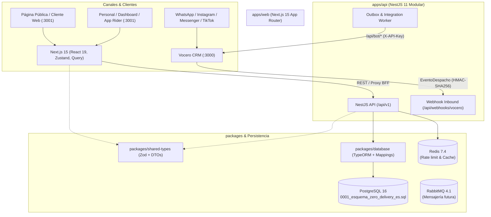
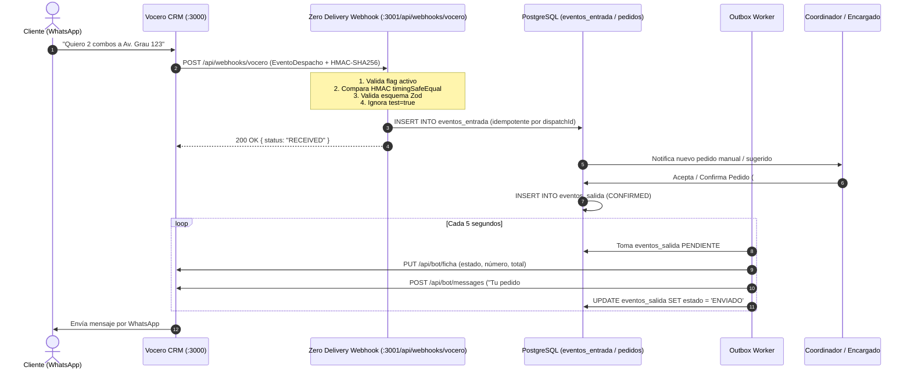

# Zero Delivery — Plan Maestro de Implementación por Fases

> **Versión del Plan:** 1.0  
> **Fecha:** 2026-10-26  
> **Alcance:** Creación integral del sistema Zero Delivery (Backend NestJS, Frontend Next.js, Base de Datos PostgreSQL en español, Roles operativos, PWA y Conector bidireccional con Vocero CRM).

---

## 1. Visión General de la Arquitectura

Zero Delivery está diseñado como un **monorepo pnpm** modular que desacopla la API del negocio (`apps/api`) de la experiencia de usuario y BFF (`apps/web`), compartiendo contratos y acceso a datos mediante paquetes internos (`packages/*`).



---

## 2. Mapa de Fases de Implementación

El plan se divide en **6 fases secuenciales e incrementales**:

| Fase | Título | Objetivo Clave | Duración Estimada |
|---|---|---|---|
| **Fase 0** | **Fundación del Workspace e Infraestructura** | Puesta en marcha de Docker, scripts, compilación base de paquetes compartidos y base de datos con esquema canónico. | 1 semana |
| **Fase 1** | **Capa de Datos y Dominio Compartido** | Entidades TypeORM en español mapeando `0001_esquema_zero_delivery_es.sql`, validaciones Zod y utilitarios de moneda/tiempo. | 1 - 2 semanas |
| **Fase 2** | **Backend Modular (NestJS Core)** | Módulos de identidad (RBAC `can()`), catálogo, clientes, pedidos (máquina de estados), pagos y logística de repartidores. | 3 semanas |
| **Fase 3** | **Frontend y PWA (Next.js 15)** | Layout por roles (Admin, Coordinador, Encargado, Empleado, Repartidor), Kanban operativo, vista móvil de rider y PWA offline-ready. | 3 semanas |
| **Fase 4** | **Integración Bidireccional con Vocero CRM** | Webhook entrante HMAC, `eventos_entrada`, vinculación cliente-conversación, outbox saliente (`/api/bot/*`) y descarga de comprobantes. | 2 semanas |
| **Fase 5** | **Alertas, Auditoría, Reportes y Endurecimiento** | Dashboard por periodos, exportador CSV streaming con BOM, tests E2E Playwright, backup/restore y simulacro de día real. | 1 - 2 semanas |

---

## 3. Detalle Paso a Paso por Fase

### Fase 0: Fundación del Workspace e Infraestructura Base

#### 0.1 Configuración de Docker Compose y Servicios
- Ajustar `zero-delivery/docker-compose.yml` para asegurar la provisión de:
  - **PostgreSQL 16.10** en puerto `5434` (para no colisionar con el PostgreSQL de Vocero CRM en 5432).
  - **Redis 7.4.2** en puerto `6380`.
  - **RabbitMQ 4.1.4** en puerto `5673`/`15673`.
  - **MongoDB 7.0.16** en puerto `27018` (quedará provisionado según manifiesto, sin usarse como fuente del catálogo).
- Crear script de inicialización `scripts/init-db.sh` o `scripts/init-db.ps1` que cargue y valide el script canónico `0001_esquema_zero_delivery_es.sql` sobre la base vacía `zero_delivery`.

#### 0.2 Paquetes Compartidos (`packages/`)
- **`packages/config`**:
  - Definir `tsconfig.base.json` para Node/NestJS y Next.js.
  - Configuración compartida de ESLint y Prettier.
- **`packages/shared-types`**:
  - Estructurar carpetas: `src/identity`, `src/catalog`, `src/orders`, `src/payments`, `src/logistics`, `src/vocero`.
  - Definir DTOs tipados con inferencia Zod: `CustomerOrderDTO`, `StaffOrderDTO`, `BranchManagerOrderDTO`.
  - Exportar enums lógicos alineados con los valores de base de datos en español.
- **`packages/database`**:
  - Configurar conexión TypeORM hacia PostgreSQL.
  - Implementar script de prueba de conexión y verificación de extensiones (`pg_trgm`, `gen_random_uuid()`).

---

### Fase 1: Capa de Datos, Dominio y Mapeo Canónico

#### 1.1 Mapeo Fiel del DDL Canónico en TypeORM (`packages/database`)
El DDL `0001_esquema_zero_delivery_es.sql` es la **única fuente de verdad** de la BD. `TypeORM` debe configurarse con `synchronize: false`:

- **Entidades de Organización e Identidad**:
  - `InquilinoEntity` (`inquilinos`), `ContadorInquilinoEntity` (`contadores_inquilino`).
  - `UsuarioEntity` (`usuarios`), `SesionEntity` (`sesiones`).
  - `RestauranteEntity` (`restaurantes`), `SucursalEntity` (`sucursales`), `AccesoUsuarioSucursalEntity` (`acceso_usuario_sucursal`).
  - `HorarioSucursalEntity` (`horarios_sucursal`), `ZonaEntregaEntity` (`zonas_entrega`).
- **Entidades de Catálogo**:
  - `CategoriaEntity` (`categorias`), `ProductoEntity` (`productos`), `ArchivoEntity` (`archivos`).
  - `GrupoModificadoresEntity`, `OpcionModificadorEntity`, `CartaEntity`, `ItemCartaEntity`.
- **Entidades de Clientes y Logística**:
  - `ClienteEntity` (`clientes`), `DireccionClienteEntity` (`direcciones_cliente`).
  - `RepartidorEntity` (`repartidores`), `UbicacionRepartidorEntity` (`ubicaciones_repartidor`).
- **Entidades de Pedidos y Finanzas (Inmutables por Trigger)**:
  - `PedidoEntity` (`pedidos`), `DetallePedidoEntity` (`detalle_pedido`), `ModificadorDetallePedidoEntity`.
  - `HistorialEstadosPedidoEntity` (`historial_estados_pedido` — *solo inserción*).
  - `PagoEntity` (`pagos`), `EventoPagoEntity` (`eventos_pago` — *solo inserción*), `PagoRestauranteEntity` (`pagos_restaurante`).
  - `LiquidacionEntity` (`liquidaciones`), `AdelantoRepartidorEntity` (`adelantos_repartidor`).
  - `MovimientoBilleteraEntity` (`movimientos_billetera` — *libro mayor, solo inserción*).
  - `IncidenciaPedidoEntity` (`incidencias_pedido`), `IntentoEntregaEntity` (`intentos_entrega`).
  - `EventoEntradaEntity` (`eventos_entrada`), `EventoSalidaEntity` (`eventos_salida`), `RegistroAuditoriaEntity` (`registro_auditoria`).

#### 1.2 Utilitarios de Dominio Críticos
- `money.ts`: Funciones para operaciones monetarias exclusivamente en céntimos enteros (`Cents` / `bigint`), formateo a `S/ X.XX` (PEN). Cero uso de `float`.
- `time.ts`: Fechas siempre en UTC (`timestamptz`), con helpers de visualización y límites de día en zona horaria `America/Lima`.
- `phone.ts`: Normalizador estricto E.164 para números peruanos (`+519XXXXXXXX`).

---

### Fase 2: Backend Modular (NestJS en `apps/api`)

#### 2.1 Módulo de Identidad y Autenticación (`IdentityModule`)
- **Autenticación**:
  - Login por `slug` de inquilino + `nombre_usuario` + contraseña (`scrypt`/`argon2id`).
  - Protección de fuerza bruta: 5 intentos fallidos = bloqueo de 15 minutos en `usuarios.bloqueado_hasta`.
  - Sesiones persistidas en `sesiones` (almacenando únicamente `hash_token` SHA-256).
  - Middleware de autenticación y extracción del `ActorContext` (`tenantId`, `userId`, `role`, `branchIds`, `requestId`).
- **Motor de Permisos `can(actor, action, resource, settings)`**:
  - Archivo único: `modules/identity/domain/permissions.ts`.
  - Implementación estricta de la matriz de 47 permisos.
  - Suite de tests unitarios **table-driven** que recorra exhaustivamente *Rol × Permiso*.

#### 2.2 Módulo de Configuración y Auditoría (`SettingsModule` & `AuditModule`)
- `SettingsService`: Lectura y actualización de `configuraciones` con tipos Zod y fallback seguro a marcadores predeterminados (`sembrar_configuracion_predeterminada`).
- `AuditService`: Inserción append-only en `registro_auditoria` con actor, acción, recurso, metadata y cambios antes/después.

#### 2.3 Módulo de Catálogo y Sucursales (`CatalogModule`)
- CRUD de restaurantes, sucursales y zonas de entrega.
- Gestión de productos con bandera `es_fragil` y archivado lógico (`archivado_en`).
- Modificadores y cartas con precios independientes por sucursal.
- Control de alcance: `BRANCH_MANAGER` solo opera en sus sucursales asignadas.

#### 2.4 Módulo de Pedidos (Núcleo Operativo `OrdersModule`)
- **Máquina de Estados Transaccional**:
  - Implementar la tabla de transiciones puras descrita en el Build Spec.
  - Transacciones ACID con `SELECT ... FOR UPDATE` sobre `pedidos` y chequeo de bloqueo optimista con `pedidos.version`.
  - Ejecución de disparadores de auditoría y encolado en `eventos_salida` (Outbox).
- **Regla de Liberación (`evaluateReleaseGate`)**:
  - Función pura que valida:
    1. Repartidor asignado y elegible.
    2. Pago cliente validado (si es prepago Yape/transferencia).
    3. Pago restaurante confirmado (`pagos_restaurante.estado = 'CONFIRMADO'`).
    4. Traspaso físico (`handoff`) registrado por Encargado.
- **Creación Manual e Idempotencia**:
  - Uso de cabecera `Idempotency-Key` respaldada por el índice único de `pedidos.clave_idempotencia`.
  - Generación de número de pedido mediante `siguiente_contador()`.
  - Cálculo de snapshot de precios (`precio_base`, `empaque`, `margen_centavos` provisional).

#### 2.5 Módulo de Pagos y Liquidaciones (`PaymentsModule` & `LogisticsModule`)
- Validación de comprobantes: endpoint para que Coordinador/Empleado valide comprobante humano (`validado_por`, `validado_en`).
- Confirmación de pago al restaurante (`confirmado_por`, `confirmado_en`).
- Elegibilidad de repartidores (`canAssignRider`): validación de vehículo para frágil, estado, y garantía mínima/deuda en pedidos de efectivo.
- Billetera/Ledger: registro de `movimientos_billetera` (`EFECTIVO_COBRADO` negativo al entregar, `DEPOSITO_GARANTIA`, etc.).
- Proceso de Liquidación Diaria (`liquidaciones`): corte a las 23:00, cálculo de neto, deducción de adelantos autorizados.

---

### Fase 3: Frontend y PWA (Next.js 15 en `apps/web`)

#### 3.1 Estructura Base, UI y Diseño
- Configuración de Tailwind CSS con paleta y tipografía limpia, componentes accesibles (tamaño táctil ≥ 44px).
- App Shell PWA: Manifest (`manifest.json`), service worker, iconos y soporte offline informativo (las mutaciones requieren conexión).
- Un solo portal de login en `/login` que redirige dinámicamente según el rol.
- Polling optimizado en `useLiveOrders` con intervalo configurable (5-10s) con `If-None-Match`/`ETag`.

#### 3.2 Vistas Específicas por Rol
1. **Administrador (`/dashboard/admin`)**:
   - Gestión de usuarios y asignación de sucursales.
   - Configuración global de inquilino (edición de umbrales y feature flags).
   - Reportes globales y visor de auditoría inmutable.
2. **Coordinador (`/dashboard/coordinator`)**:
   - Kanban operativo global con columnas por estado.
   - Modal de asignación manual de repartidores con selector filtrado por elegibilidad.
   - Bandeja de validación de comprobantes y autorización de cancelaciones / 2dos intentos.
   - Gestión de garantías, adelantos y confirmación de liquidaciones diarias.
3. **Encargado de Sucursal (`/dashboard/branch`)**:
   - Vista simplificada (Cocina / Despacho): pedidos nuevos con sonido de alerta.
   - Botones gigantes para: *Aceptar*, *Preparar*, *Marcar Listo*, *Registrar Handoff*.
   - Gestión de disponibilidad de platos (marcar faltantes).
   - Confirmación de recepción física de devoluciones.
4. **Empleado / Atención al Cliente (`/dashboard/support`)**:
   - Formulario de creación de pedido manual telefónico/chat.
   - Ficha de cliente con historial y direcciones guardadas.
   - Búsqueda de pedidos, registro de notas de soporte y solicitud de cancelaciones.
5. **Repartidor (`/rider`)**:
   - Mobile-first extremo: pantalla de pedido asignado actual.
   - Indicador claro de cobro: **"YA PAGADO - NO COBRAR"** vs **"COBRAR EN EFECTIVO: S/ XX.XX"**.
   - Acciones: *Llegué al local*, *En camino*, *Entregado* (con input de cobro), *Entrega fallida* (motivo + foto opcional).
   - Botón *Compartir mi ubicación* (`navigator.geolocation`).
   - Pestaña *Mi Billetera* (saldo de garantía y liquidación del día).

---

### Fase 4: Integración Bidireccional con Vocero CRM

Vocero CRM ya está presente en el repositorio en `vocero-crm` (Next.js 15, Drizzle ORM, Better Auth, SSE, WhatsApp Cloud API). La integración debe seguir escrupulosamente el principio: **"Vocero conversa; Zero Delivery opera"**.



#### 4.1 Brecha de Datos a Resolver en la BD
- Como se documentó en `06-VOCERO_CRM.md`, actualmente `clientes` y `pedidos` no tienen campo para persistir el ID de conversación de Vocero.
- **Acción técnica:**
  - Crear migración SQL incremental:
    ```sql
    ALTER TABLE clientes ADD COLUMN IF NOT EXISTS vocero_conversacion_id text;
    ALTER TABLE pedidos ADD COLUMN IF NOT EXISTS vocero_conversacion_id text;
    CREATE INDEX IF NOT EXISTS clientes_vocero_conv_idx ON clientes (vocero_conversacion_id);
    CREATE INDEX IF NOT EXISTS pedidos_vocero_conv_idx ON pedidos (vocero_conversacion_id);
    ```

#### 4.2 Webhook Inbound (`POST /api/webhooks/vocero`)
- Validar `feature.integration.vocero` (o variable `FEATURE_INTEGRATION_VOCERO`). Si está inactivo, responder `404 Not Found`.
- Leer el cuerpo crudo (`Buffer` / `text`) para validar la firma HMAC-SHA256:
  - Header: `X-Vocero-Signature: sha256=<hex>`.
  - Comparar con `crypto.timingSafeEqual` usando `VOCERO_BOT_API_KEY`.
- Validar con el esquema Zod `voceroDispatchEventSchema`:
  - Si `conversation.test === true`, responder `200 { status: "IGNORED_TEST_CONVERSATION" }`.
  - Guardar el evento en `eventos_entrada` con `proveedor = 'vocero'` y `id_evento_externo = dispatchId`. El trigger/índice único descarta duplicados sin error.

#### 4.3 Worker de Entrada (Procesamiento de Mensajes)
- Buscar o crear cliente a partir de `contact.identity` (teléfono E.164) y vincular `vocero_conversacion_id`.
- Si el mensaje incluye un comprobante (`mediaId`), descargar el archivo mediante `GET /api/bot/media/:mediaId` con `X-API-Key` y guardarlo en `archivos` vinculado al pago del pedido.
- Si el cliente solicita atención humana, registrar nota de soporte o disparar `requestHumanHandoff`.
- **Regla inquebrantable:** Ningún webhook aprueba un pago ni despacha un pedido automáticamente.

#### 4.4 Worker de Salida (Outbox Pattern)
- Implementar cron o worker en background que consulte `eventos_salida` con `estado = 'PENDIENTE'`.
- Por cada evento:
  1. `PUT /api/bot/ficha`: actualiza la ficha del contacto en Vocero (último pedido `#1042`, estado `En preparación`, total `S/ 48.50`).
  2. `POST /api/bot/messages`: envía mensaje informativo al cliente (plantillas en español para creación, confirmación, despacho y entrega).
  3. Manejo de errores tipados de Vocero (`409 ai_paused`, `window_closed`): en caso de ventana cerrada, marcar evento y no reintentar en bucle; si falla tras 5 intentos, mover a `MUERTO` y alertar `INTEGRATION_DEAD_LETTER`.

#### 4.5 Pantalla de Gestión de Integración
- Implementar en el Dashboard de Admin `/dashboard/integrations`:
  - Toggle de activación de la integración.
  - Indicador de estado y healthcheck con Vocero (`/api/webhooks/vocero/health`).
  - Monitor de eventos en `eventos_entrada` y `eventos_salida`.
  - Visor de eventos fallidos o en cola muerta con botón para **Reprocesar**.

---

### Fase 5: Reportes, Endurecimiento, E2E y Cierre

#### 5.1 Reportería y Exportación CSV
- Implementar servicio `ReportingService`:
  - Ventas por día/semana/mes, ticket promedio, platos más vendidos.
  - Métricas operativas: tiempo promedio de aceptación, tiempo en cocina, tasa de éxito vs fallidas.
  - Reporte de clientes: nuevos vs recurrentes vs top.
  - Métricas de repartidor: entregas completadas, efectivo cobrado, liquidación.
- Exportación en CSV con `stream`, codificación UTF-8 con **BOM** (para apertura perfecta en Excel), separador de comas y fechas en `America/Lima`.

#### 5.2 Endurecimiento de Seguridad y Auditoría
- Sanitización de logs (prohibido escribir teléfonos completos, claves o payloads financieros en claro).
- Verificación de políticas de cookies (`httpOnly`, `SameSite=Lax`, `Secure`).
- Verificación de inmutabilidad: pruebas automatizadas intentando hacer `UPDATE` y `DELETE` sobre `registro_auditoria`, `historial_estados_pedido` y `movimientos_billetera`, comprobando que los triggers de PostgreSQL lancen excepción `restrict_violation`.

#### 5.3 Pruebas de Integración y E2E (Playwright)
- **Flujo 1: Pedido Feliz en Efectivo**:
  - Empleado crea pedido manual.
  - Encargado acepta, prepara y marca listo.
  - Coordinador confirma pago a restaurante y asigna rider elegible.
  - Encargado registra handoff.
  - Rider marca retiro, entrega y registra cobro de efectivo.
  - Verificación de balance de garantía y liquidación.
- **Flujo 2: Pedido Prepago Yape con Guarda de Liberación**:
  - Intento de marcar `ON_THE_WAY` sin validar pago -> Rechazo `403/PREPAID_PAYMENT_NOT_VALIDATED`.
  - Validación humana del comprobante -> Despacho exitoso.
- **Flujo 3: Entrega Fallida y Devolución**:
  - Intento 1 fallido -> Autorización de segundo intento.
  - Falla de 2do intento -> Devolución física al restaurante confirmada por Encargado -> Resolución por Coordinador.

---

## 4. Matriz de Entregables por Hito

```
[Hito 0] Workspace, Docker (PG 5434, Redis, Rabbit), scripts de seed y DDL canónico ejecutado. [COMPLETADO ✅]
   │
[Hito 1] TypeORM Entities en packages/database, modelos Zod en packages/shared-types. [COMPLETADO ✅]
   │
[Hito 2] API NestJS: Auth (scrypt), RBAC can(), Catálogo, Pedidos (FSM + Release Gate), Pagos. [COMPLETADO ✅]
   │
[Hito 3] Web Next.js: App Shell PWA, Logins por rol, Kanban Coordinador, Vista Cocina, App Rider.
   │
[Hito 4] Conector Vocero CRM: Inbound HMAC, Outbox Worker, Sincronización de Ficha y Mensajes.
   │
[Hito 5] Reportería CSV BOM, Tests E2E Playwright, Validaciones de Inmutabilidad y Auditoría.
```

---

## 5. Decisiones Pendientes (Mantenidas como Parámetros)

Conforme a la especificación oficial, las siguientes decisiones de negocio se implementan como **parámetros configurables** en la tabla `configuraciones` con etiqueta `es_marcador = true`:
1. `DECISION-01`: Fórmula definitiva del margen (actualmente provisional: `precio_base + empaque + margen`).
2. `DECISION-02`: Monto mínimo de garantía y edad mínima para cobro en efectivo sin fianza (actualmente 35 años).
3. `DECISION-03`: Fórmula final de la tarifa pagable al repartidor.
4. `DECISION-04`: Permiso de Encargado para ver ventas de su sucursal (por defecto apagado).
5. `DECISION-05`: Umbrales de alerta de aceptación (5 min) y preparación (30 min).
6. `DECISION-07`: Protocolo tras superar los 15 min de espera del repartidor en sucursal (solo alerta).
