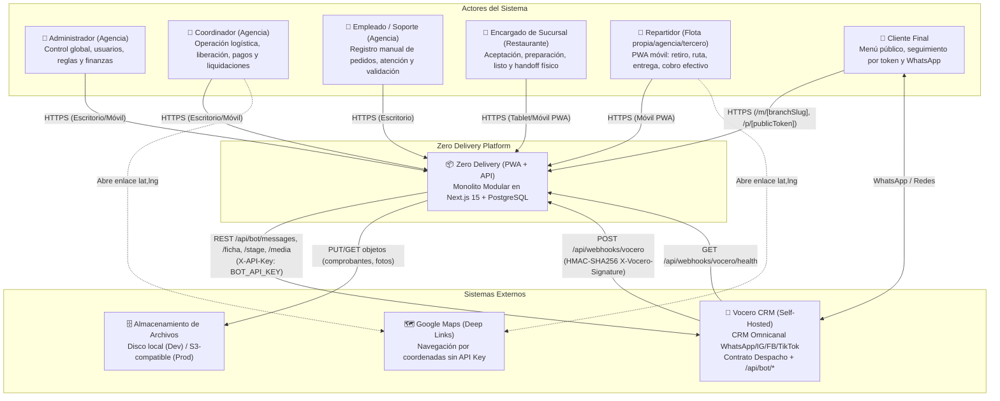
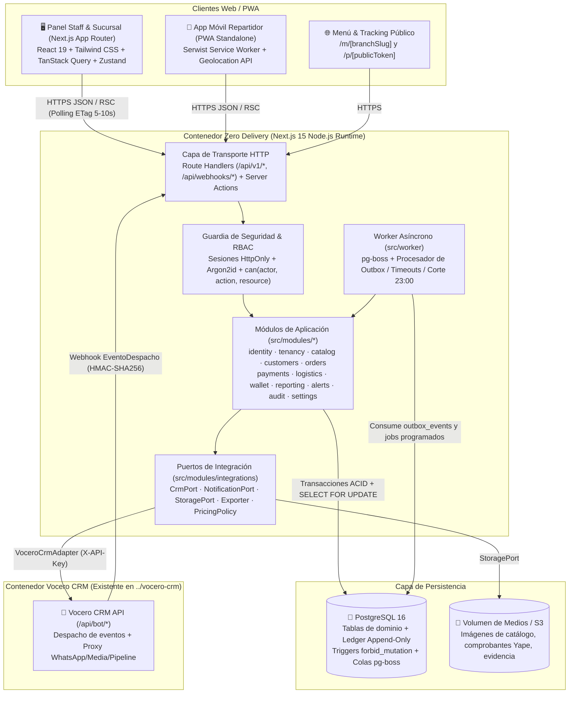

# 01 — Arquitectura del Sistema (C4)

> **Estado:** `[DESIGNED]` · **Versión:** 1.0-mvp · **Fuente:** `docs/ZERO_DELIVERY_MVP_BUILD_SPEC.md` + análisis de integración con `vocero-crm`

---

## 1. Nivel 1 — Diagrama de Contexto del Sistema (C4 Context)

Zero Delivery es una plataforma multi-restaurante operada por una agencia de delivery en Perú (`es-PE`, moneda `PEN`, zona horaria `America/Lima`). Centraliza pedidos, preparación en locales independientes, validación humana de pagos anticipados, regla de liberación de despacho, logística de repartidores, libro mayor inmutable de garantías/liquidaciones y reportería por rol.

Se diseña para interoperar bidireccionalmente con **Vocero CRM** (`vocero-crm`) actuando como sistema operativo de pedidos y —cuando el feature flag `feature.integration.vocero` esté activo— recibiendo eventos de despacho firmados (`X-Vocero-Signature`) y notificando cambios de estado, etapas del pipeline y mensajes al cliente a través de la API `/api/bot/*` de Vocero CRM (de modo que el token de WhatsApp Cloud API jamás salga de Vocero CRM).

---

## 2. Nivel 2 — Diagrama de Contenedores (C4 Container)

Siguiendo el principio de **Monolito Modular** (`ZERO_DELIVERY_MVP_BUILD_SPEC.md` §2–§4) y alineado con el stack probado de `vocero-crm`, Zero Delivery se ejecuta como una aplicación Next.js 15 (App Router) respaldada por PostgreSQL 16 (datos relacionales, libro mayor inmutable y cola transaccional `outbox_events` / `pg-boss`).

---

## 3. Arquitectura Interna de Módulos y Reglas de Dependencia

Cada módulo en `src/modules/<modulo>/` se divide estrictamente en 4 capas:

| Capa | Directorio | Responsabilidad | Dependencias Permitidas |
|---|---|---|---|
| **Dominio** | `domain/` | Entidades puras, tipos, invariantes, máquina de estados (`transitions.ts`), `evaluateReleaseGate`, `canAssignRider`, `can()`, políticas de precios. | Ninguna librería de infra, ni BD, ni Next.js. Solo `src/shared/*`. |
| **Aplicación** | `application/` | Casos de uso, orquestación transaccional, autorización con `can(actor, ...)`, registro en `audit_logs` y encolado en `outbox_events`. | `domain/` del propio módulo, API pública (`index.ts`) de otros módulos, puertos. |
| **Infraestructura** | `infra/` | Repositorios Drizzle (`tenantId` obligatorio), adaptadores concretos (`VoceroCrmAdapter`, `LocalStorageAdapter`, `CsvStreamExporter`). | `domain/`, `application/` (interfaces/puertos), `src/db/*`, SDKs/HTTP. |
| **UI** | `ui/` | Componentes React, hooks (`useLiveOrders`), formularios Zod + React Hook Form. | `application/` (vía Server Actions o cliente `/api/v1`). Nunca importa `infra/` ni `src/db/`. |

---

## 4. Arquitectura de Integración Futura con Vocero CRM (`[DESIGNED]`)

Tras analizar el repositorio existente en `C:\Users\Zero\Documents\max\zero-delivery\vocero-crm` (específicamente `src/server/brains/contract.ts` y `docs/openapi.json`), la comunicación entre ambos sistemas se diseña sin acoplamiento directo a la base de datos de Vocero CRM:

1. **Canal de Entrada (Vocero CRM → Zero Delivery):**
   - Vocero CRM configura `BRAIN_DISPATCH_URL=https://<zero-delivery>/api/webhooks/vocero` y `BRAIN_HEALTH_URL=https://<zero-delivery>/api/webhooks/vocero/health` compartiendo el secreto `BOT_API_KEY` (o `VOCERO_WEBHOOK_SECRET`).
   - Cuando el cliente escribe por WhatsApp/Instagram/Messenger/TikTok, Vocero CRM envía un `POST` con el cuerpo `EventoDespacho` y las cabeceras:
     - `X-Vocero-Signature: sha256=<HMAC-SHA256(rawBody, secret)>`
     - `X-Vocero-Dispatch-Id: <dispatchId>`
     - `X-Vocero-Organization: <orgId>`
   - Zero Delivery verifica la firma HMAC en tiempo constante (`timingSafeEqual`), persiste el evento en `inbound_events` con `UNIQUE(provider='vocero', external_event_id=dispatchId)` (garantizando idempotencia: si es duplicado devuelve `200 OK` inmediato) y encola su procesamiento.
   - Si el mensaje incluye una captura de pago (`mediaId`), Zero Delivery puede descargarla invocando `GET {VOCERO_BASE_URL}/api/bot/media/{mediaId}` con `X-API-Key: {VOCERO_BOT_API_KEY}` y guardarla en `StoragePort` como comprobante pendiente de validación humana (`proof_asset_id`).

2. **Canal de Salida (Zero Delivery → Vocero CRM):**
   - Cada transición de estado del pedido (`CONFIRMED`, `READY`, `ON_THE_WAY`, `DELIVERED`, `DELIVERY_FAILED`, etc.) escribe un registro en `outbox_events` dentro de la misma transacción SQL.
   - Cuando `settings['feature.integration.vocero'] === true`, el worker consume `outbox_events` e invoca `VoceroCrmAdapter` (`CrmPort` + `NotificationPort`):
     - `POST /api/bot/messages`: Envía la notificación de estado al cliente en su conversación activa de WhatsApp (respetando los códigos `409 window_closed` o `ai_paused`).
     - `PUT /api/bot/ficha`: Sincroniza el resumen del cliente (`ultimoPedidoNumero`, `totalPedidos`, `segmento`, `direccionHabitual`).
     - `POST /api/bot/stage`: Avanza la etapa del lead en el pipeline Kanban de Vocero CRM.
     - `POST /api/bot/handoff`: Escala la conversación a un agente humano de soporte cuando ocurre una incidencia (`UNAVAILABLE` item, `DELIVERY_FAILED`, o solicitud de cambio de dirección).

3. **Aislamiento en el MVP:**
   - En el MVP, `feature.integration.vocero` viene en `false` por defecto. El endpoint `/api/webhooks/[provider]` devuelve `404` cuando el flag está apagado (siguiendo la misma convención de módulos opcionales de Vocero CRM), pero toda la infraestructura (`inbound_events`, `outbox_events`, `CrmPort`, `VoceroCrmAdapter` y verificador HMAC) queda lista y probada unitariamente.

---

## 5. Protocolos, Puertos y Servicios de Infraestructura

| Servicio | Tecnología | Puerto (Dev) | Protocolo | Propósito |
|---|---|---|---|---|
| `zero-delivery-web` | Next.js 15 (App Router) | `3001` (para no colisionar con `vocero-crm` en `3000`) | HTTP/HTTPS | UI Staff, UI Rider PWA, Menú Público y API `/api/v1/*` + `/api/webhooks/*` |
| `zero-delivery-db` | PostgreSQL 16 Alpine | `5433` (host) → `5432` (container) | TCP (`postgres://`) | Persistencia principal, triggers append-only, colas `pg-boss` |
| `zero-delivery-worker` | Node.js / `pg-boss` | N/A (proceso background o in-process) | TCP a Postgres + HTTPS saliente | Procesamiento de `outbox_events`, alertas de timeout y corte de liquidación (23:00 `America/Lima`) |
| `vocero-crm` (externo) | Next.js 15 + Postgres 16 | `3000` | HTTP/HTTPS REST + Webhooks HMAC | CRM omnicanal de WhatsApp y gestión de conversaciones |
