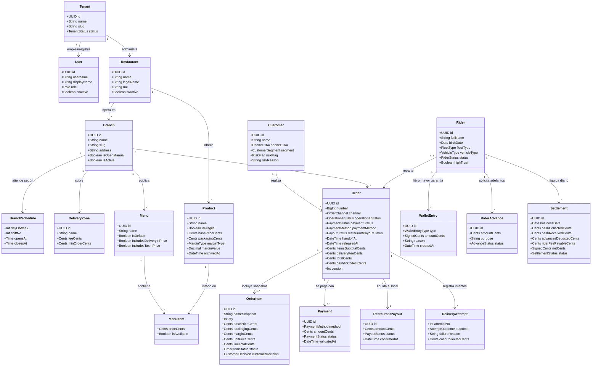

# 03 — Modelo de Dominio Conceptual

> **Estado:** `[DESIGNED]` · **Versión:** 1.0-mvp · **Fuente:** `docs/ZERO_DELIVERY_MVP_BUILD_SPEC.md` §6–§10

---

## 1. Diagrama de Clases Conceptual (Mermaid)

---

## 2. Responsabilidad de las Entidades de Dominio

| Entidad | Módulo | Responsabilidad de Negocio e Invariantes Clave |
|---|---|---|
| **Tenant** | `tenancy` | Representa la agencia operadora (aislamiento lógico multi-tenant desde el día 1). |
| **User** | `identity` | Actor autenticado con uno de los 5 roles (`ADMIN`, `COORDINATOR`, `BRANCH_MANAGER`, `SUPPORT_AGENT`, `RIDER`) y alcance opcional por sucursales (`user_branch_access`). |
| **Restaurant & Branch** | `tenancy` | Separa la marca gastronómica (`Restaurant`) del punto físico de despacho (`Branch`). Cada sucursal gestiona sus turnos (`BranchSchedule`), su interruptor manual (`isOpenManual`) y sus zonas de reparto (`DeliveryZone`). |
| **Product, Modifier & Menu** | `catalog` | Define el catálogo con desglose de costos internos (`basePriceCents`, `packagingCents`, `marginType`, `marginValue`) y marca `isFragile`. Nunca se elimina físicamente si tuvo ventas (`archivedAt`). |
| **Customer** | `customers` | Identificado de forma única por `(tenantId, phoneE164)`. Posee clasificación comercial (`NEW`, `RECURRING`, `TOP`) e indicador de seguridad manual auditado (`riskFlag`: `NONE`, `CAUTION`, `BLOCKED`). |
| **Order & OrderItem** | `orders` | Agregado central. Separa estrictamente `operationalStatus`, `paymentStatus` y `restaurantPayoutStatus`. Guarda snapshots de precios y modificadores en `OrderItem` para que cambios futuros de catálogo no alteren la contabilidad histórica. |
| **Payment & RestaurantPayout** | `payments` | Separa el cobro al cliente (`Payment` + bitácora inmutable `PaymentEvent`) del pago que la agencia realiza al encargado del restaurante antes del retiro (`RestaurantPayout`). |
| **Rider & DeliveryAttempt** | `logistics` | Modela al repartidor (flota propia, agencia externa o tercero), su vehículo (`MOTO`/`CAR`), elegibilidad para efectivo (edad ≥ 35 o `highTrust` o garantía suficiente) y hasta 2 intentos de entrega por pedido. |
| **WalletEntry, RiderAdvance & Settlement** | `wallet` | Implementa el libro mayor de solo-inserción (`WalletEntry`) donde el saldo de garantía es siempre `SUM(amount_cents)`. Los cobros en efectivo restan garantía (`CASH_COLLECTED -`) y las entregas de efectivo en la liquidación diaria de las 23:00 la restauran (`CASH_SETTLED +`). |
