# 04 — Diagrama Entidad-Relación (Modelo Físico PostgreSQL)

> **Estado:** `[DESIGNED]` · **Versión:** 1.0-mvp · **Fuente:** `zero_delivery_schema v1 no oficial.sql` + `docs/ZERO_DELIVERY_MVP_BUILD_SPEC.md` §9

---

## 1. Convenciones Físicas de Base de Datos

- **Motor:** PostgreSQL 16+ con extensión `pg_trgm` (búsqueda trigram en nombres de productos y clientes).
- **Claves Primarias:** `uuid` (`gen_random_uuid()`).
- **Aislamiento Multi-Tenant:** Toda tabla de negocio incluye `tenant_id uuid NOT NULL REFERENCES tenants(id)` e índices compuestos encabezados por `tenant_id`.
- **Dinero:** `bigint` en **céntimos enteros** (`S/ 15.50` = `1550`). Prohibido `float`/`real` para importes monetarios.
- **Tiempos:** `timestamptz` en UTC en almacenamiento; conversión a `America/Lima` en capa de presentación y cortes operativos (`settlements.business_date`).
- **Tablas Append-Only (Solo-Inserción):** `audit_logs`, `order_status_history`, `payment_events`, `wallet_entries` cuentan con triggers `BEFORE UPDATE OR DELETE OR TRUNCATE` que ejecutan `forbid_mutation()`. `inbound_events` cuenta con `inbound_events_guard()` que solo permite actualizar `status`, `processed_at`, `error` y `attempts`.

---

## 2. Diagrama ER Físico (Mermaid)

```mermaid
erDiagram
    TENANTS ||--o{ USERS : "has"
    TENANTS ||--o{ RESTAURANTS : "owns"
    TENANTS ||--o{ CUSTOMERS : "registers"
    TENANTS ||--o{ RIDERS : "manages"
    TENANTS ||--o{ ORDERS : "processes"
    TENANTS ||--o{ SETTINGS : "configures"
    TENANTS ||--o{ AUDIT_LOGS : "audits"

    USERS ||--o{ SESSIONS : "authenticates"
    USERS ||--o{ USER_BRANCH_ACCESS : "scoped_to"
    BRANCHES ||--o{ USER_BRANCH_ACCESS : "grants"

    RESTAURANTS ||--o{ BRANCHES : "has"
    RESTAURANTS ||--o{ CATEGORIES : "organizes"
    RESTAURANTS ||--o{ PRODUCTS : "catalogs"
    RESTAURANTS ||--o{ MODIFIER_GROUPS : "defines"

    BRANCHES ||--o{ BRANCH_SCHEDULES : "schedules"
    BRANCHES ||--o{ DELIVERY_ZONES : "covers"
    BRANCHES ||--o{ MENUS : "publishes"
    BRANCHES ||--o{ ORDERS : "fulfills"

    MENUS ||--o{ MENU_ITEMS : "lists"
    PRODUCTS ||--o{ MENU_ITEMS : "priced_in"
    PRODUCTS ||--o{ PRODUCT_MODIFIER_GROUPS : "allows"
    MODIFIER_GROUPS ||--o{ PRODUCT_MODIFIER_GROUPS : "attached_to"
    MODIFIER_GROUPS ||--o{ MODIFIER_OPTIONS : "contains"

    CUSTOMERS ||--o{ CUSTOMER_ADDRESSES : "saves"
    CUSTOMERS ||--o{ ORDERS : "places"

    ORDERS ||--|{ ORDER_ITEMS : "contains"
    ORDER_ITEMS ||--o{ ORDER_ITEM_MODIFIERS : "customizes"
    ORDERS ||--|{ ORDER_STATUS_HISTORY : "tracks"
    ORDERS ||--o{ ORDER_NOTES : "annotates"
    ORDERS ||--o{ ORDER_INCIDENTS : "reports"
    ORDERS ||--o{ DELIVERY_ATTEMPTS : "attempts"
    ORDERS ||--|{ PAYMENTS : "collects"
    ORDERS ||--|| RESTAURANT_PAYOUTS : "pays_branch"
    ORDERS ||--o{ REFUNDS : "refunds"

    PAYMENTS ||--|{ PAYMENT_EVENTS : "logs"

    RIDERS ||--o{ ORDERS : "assigned_to"
    RIDERS ||--o{ DELIVERY_ATTEMPTS : "executes"
    RIDERS ||--o{ RIDER_LOCATION_PINGS : "pings"
    RIDERS ||--o{ WALLET_ENTRIES : "ledger"
    RIDERS ||--o{ RIDER_ADVANCES : "requests"
    RIDERS ||--o{ SETTLEMENTS : "settles"

    TENANTS {
        uuid id PK
        text name
        text slug UK
        text status "ACTIVE | SUSPENDED"
        timestamptz created_at
        timestamptz updated_at
    }

    USERS {
        uuid id PK
        uuid tenant_id FK
        text username "UNIQUE(tenant_id, lower(username))"
        text password_hash "argon2id"
        text display_name
        text role "ADMIN|COORDINATOR|BRANCH_MANAGER|SUPPORT_AGENT|RIDER"
        boolean is_active
        integer failed_login_count
        timestamptz locked_until
        timestamptz last_login_at
    }

    BRANCHES {
        uuid id PK
        uuid tenant_id FK
        uuid restaurant_id FK
        text name
        text slug "UNIQUE(tenant_id, slug)"
        text address
        numeric lat
        numeric lng
        boolean is_open_manual
        boolean is_active
    }

    PRODUCTS {
        uuid id PK
        uuid tenant_id FK
        uuid restaurant_id FK
        uuid category_id FK
        text name
        boolean is_fragile
        bigint base_price_cents
        bigint packaging_cents
        text margin_type "FIXED | PERCENT"
        numeric margin_value
        boolean is_active
        timestamptz archived_at
    }

    CUSTOMERS {
        uuid id PK
        uuid tenant_id FK
        text name
        text phone_e164 "UNIQUE(tenant_id, phone_e164)"
        text segment "NEW | RECURRING | TOP"
        text risk_flag "NONE | CAUTION | BLOCKED"
        text risk_reason
        uuid risk_set_by FK
    }

    ORDERS {
        uuid id PK
        uuid tenant_id FK
        bigint number "UNIQUE(tenant_id, number)"
        uuid branch_id FK
        uuid customer_id FK
        jsonb address_snapshot
        text channel "MANUAL | WEB | WHATSAPP | CRM"
        text operational_status
        text payment_status "PENDING | PAID | REJECTED | REFUNDED"
        text payment_method "CASH | YAPE | BANK_TRANSFER"
        text restaurant_payout_status "PENDING | CONFIRMED"
        timestamptz handoff_at
        uuid handoff_by FK
        timestamptz released_at
        uuid released_by FK
        uuid rider_id FK
        bigint items_subtotal_cents
        bigint discount_cents
        bigint delivery_fee_cents
        bigint tax_cents
        bigint total_cents
        bigint cash_to_collect_cents
        text public_token UK
        text idempotency_key "UNIQUE(tenant_id, idempotency_key)"
        integer version
    }

    ORDER_ITEMS {
        uuid id PK
        uuid order_id FK
        uuid product_id FK
        text name_snapshot
        integer qty
        bigint base_price_cents
        bigint packaging_cents
        bigint margin_cents
        bigint unit_price_cents
        bigint line_total_cents
        text status "ACTIVE | UNAVAILABLE | REPLACED | CANCELLED"
        text customer_decision "ACCEPTED_REPLACEMENT | CANCELLED_ITEM"
    }

    PAYMENTS {
        uuid id PK
        uuid tenant_id FK
        uuid order_id FK
        text method "CASH | YAPE | BANK_TRANSFER"
        bigint amount_cents
        text status "PENDING | PAID | REJECTED | REFUNDED"
        uuid proof_asset_id FK
        uuid validated_by FK
        timestamptz validated_at
    }

    RESTAURANT_PAYOUTS {
        uuid id PK
        uuid tenant_id FK
        uuid order_id FK "UNIQUE"
        bigint amount_cents
        text status "PENDING | CONFIRMED"
        uuid confirmed_by FK
        timestamptz confirmed_at
    }

    RIDERS {
        uuid id PK
        uuid tenant_id FK
        uuid user_id FK "UNIQUE"
        text full_name
        text phone
        date birth_date
        text fleet_type "OWN | AGENCY | THIRD_PARTY"
        text vehicle_type "MOTO | CAR"
        text status "AVAILABLE | BUSY | ON_THE_WAY | OFFLINE"
        boolean high_trust
        boolean is_active
    }

    WALLET_ENTRIES {
        uuid id PK
        uuid tenant_id FK
        uuid rider_id FK
        text type "GUARANTEE_DEPOSIT|GUARANTEE_WITHDRAWAL|CASH_COLLECTED|CASH_SETTLED|ADJUSTMENT"
        bigint amount_cents "Signed (+ or -)"
        uuid order_id FK
        uuid settlement_id FK
        text reason
        uuid actor_id FK
        timestamptz created_at
    }

    SETTLEMENTS {
        uuid id PK
        uuid tenant_id FK
        uuid rider_id FK
        date business_date "UNIQUE(rider_id, business_date)"
        bigint cash_collected_cents
        bigint cash_received_cents
        bigint advances_deducted_cents
        bigint rider_fee_reference_cents
        bigint rider_fee_payable_cents
        bigint net_cents
        text status "DRAFT | CONFIRMED"
        uuid confirmed_by FK
    }
```

---

## 3. Catálogo de Restricciones (`CHECK` y `UNIQUE`) e Índices Críticos

| Tabla | Restricción / Índice | Definición SQL y Propósito de Negocio |
|---|---|---|
| `orders` | `orders_total_chk` | `CHECK (total_cents = items_subtotal_cents - discount_cents + delivery_fee_cents + tax_cents)` — Garantiza cuadre aritmético exacto del pedido. |
| `orders` | `orders_cash_chk` | `CHECK (cash_to_collect_cents <= total_cents AND (payment_method = 'CASH' OR cash_to_collect_cents = 0))` — Impide cobrar efectivo en pedidos pagados por Yape/Transferencia. |
| `orders` | `orders_handoff_requires_payout_chk` | `CHECK (handoff_at IS NULL OR restaurant_payout_status = 'CONFIRMED')` — Impide en BD registrar entrega física del local al repartidor si el restaurante aún no cobró. |
| `orders` | `orders_dispatch_gate_chk` | `CHECK (operational_status NOT IN ('ON_THE_WAY','DELIVERED') OR (handoff_at IS NOT NULL AND rider_id IS NOT NULL AND (payment_method = 'CASH' OR payment_status IN ('PAID','REFUNDED'))))` — Segunda barrera de la Regla de Liberación en PostgreSQL. |
| `orders` | `orders_idempotency_uq` | `UNIQUE (tenant_id, idempotency_key) WHERE idempotency_key IS NOT NULL` — Previene pedidos duplicados por reintentos de red o doble clic. |
| `payments` | `payments_validated_chk` | `CHECK (status NOT IN ('PAID','REFUNDED') OR (validated_by IS NOT NULL AND validated_at IS NOT NULL))` — Exige validador humano identificado. |
| `payment_events` | `payment_events_corrected_chk` | `CHECK (type <> 'CORRECTED' OR (reason IS NOT NULL AND before IS NOT NULL AND after IS NOT NULL))` — Exige motivo y valores previo/nuevo en toda corrección. |
| `wallet_entries` | `wallet_sign_chk` | `CHECK ((type IN ('GUARANTEE_DEPOSIT','CASH_SETTLED') AND amount_cents > 0) OR (type IN ('GUARANTEE_WITHDRAWAL','CASH_COLLECTED') AND amount_cents < 0) OR (type = 'ADJUSTMENT' AND amount_cents <> 0 AND reason IS NOT NULL))` — Protege el signo contable del libro mayor. |
| `wallet_entries` | `wallet_one_collection_per_order` | `UNIQUE (order_id) WHERE type = 'CASH_COLLECTED'` — Impide descontar dos veces el efectivo de un mismo pedido en la garantía del repartidor. |
| `wallet_entries` | `wallet_one_settled_per_settlement` | `UNIQUE (settlement_id) WHERE type = 'CASH_SETTLED'` — Impide duplicar el abono de una liquidación diaria. |
| `rider_advances` | `rider_advances_deducted_chk` | `CHECK ((status = 'DEDUCTED') = (deducted_in_settlement_id IS NOT NULL))` — Impide descontar un adelanto dos veces. |
| `inbound_events` | `inbound_events_provider_ext_uq` | `UNIQUE (provider, external_event_id)` — Deduplicación idempotente de webhooks de Vocero CRM (`dispatchId`). |
| `outbox_events` | `outbox_dedupe_uq` | `UNIQUE (tenant_id, dedupe_key) WHERE dedupe_key IS NOT NULL` — Evita encolar notificaciones duplicadas ante reintentos. |
