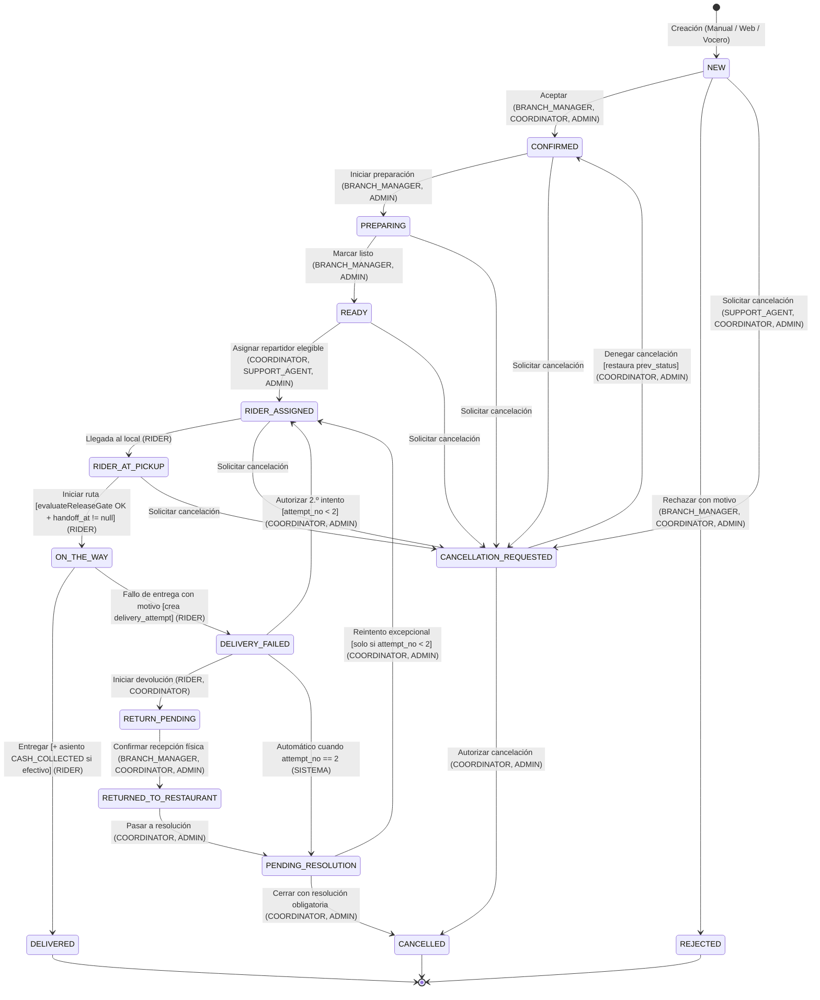
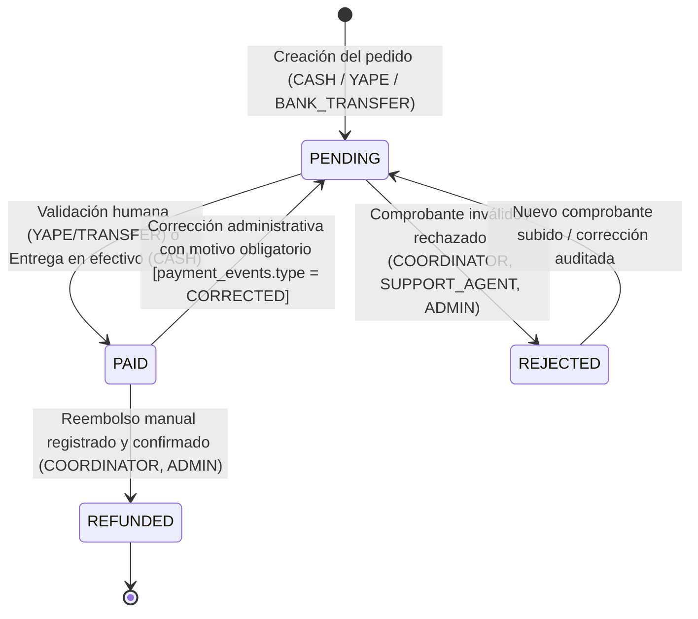
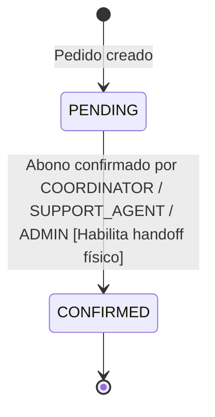
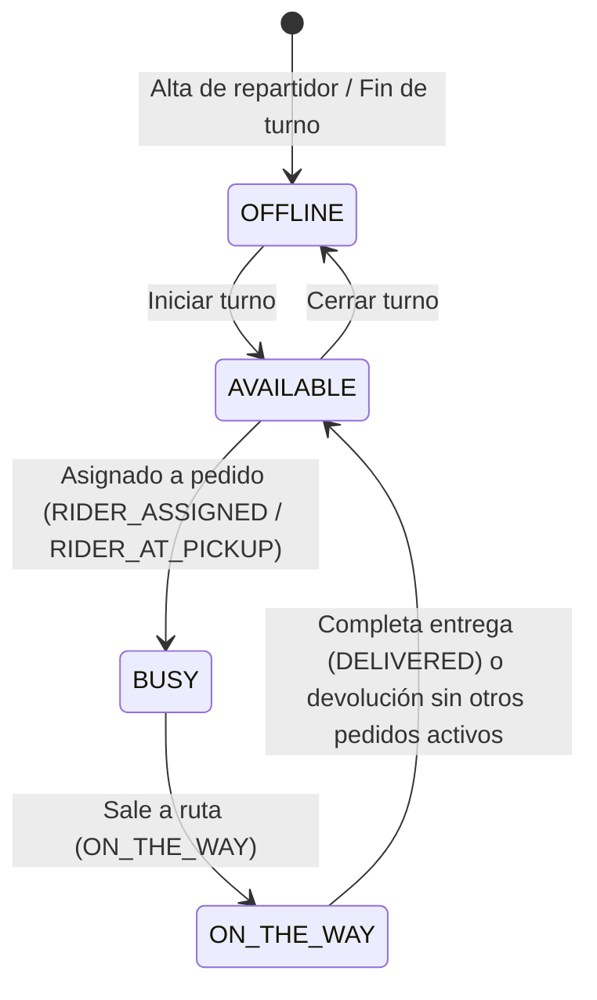
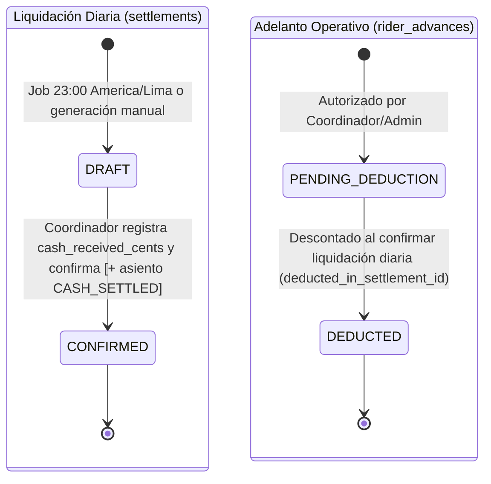

# 06 — Diagramas de Estado y Ciclo de Vida de Entidades

> **Estado:** `[DESIGNED]` · **Versión:** 1.0-mvp · **Fuente:** `docs/ZERO_DELIVERY_MVP_BUILD_SPEC.md` §8

---

## 1. Estado Operativo del Pedido (`orders.operational_status`)

Los pedidos se rigen por dos ejes principales independientes (`operational_status` y `payment_status`) más el estado de liquidación al restaurante (`restaurant_payout_status`) y el sello de entrega física (`handoff_at`).

| Estado | Etiqueta UI (`es-PE`) | Descripción | Terminal |
|---|---|---|---|
| `NEW` | Nuevo | Pedido registrado; genera alerta sonora en sucursal y corre temporizador de aceptación. | No |
| `CONFIRMED` | Confirmado | Aceptado por sucursal o coordinador. | No |
| `PREPARING` | En preparación | Cocina preparando el pedido (permitido aunque el pago anticipado siga `PENDING`). | No |
| `READY` | Listo | Empaquetado y listo para ser asignado y retirado. | No |
| `RIDER_ASSIGNED` | Repartidor asignado | Motorizado/conductor elegible asignado. | No |
| `RIDER_AT_PICKUP` | Rider cerca del punto de retiro | Repartidor en el local; corre temporizador de espera de 15 min (`rider.pickup_wait_minutes`). | No |
| `ON_THE_WAY` | En camino | Despachado tras superar `evaluateReleaseGate` (pago validado + pago a restaurante confirmado + `handoff_at`). | No |
| `DELIVERED` | Entregado | Entregado al cliente final; cobro en efectivo asentado en `wallet_entries`. | **Sí** |
| `REJECTED` | Rechazado | Rechazado antes de preparación con motivo obligatorio. | **Sí** |
| `CANCELLATION_REQUESTED` | Cancelación solicitada | Petición de anulación pendiente de autorización por Coordinador/Admin. | No |
| `CANCELLED` | Cancelado | Anulado definitivamente con motivo/resolución auditada. | **Sí** |
| `DELIVERY_FAILED` | Entrega fallida | Cliente no recibió el pedido en el intento actual (`attempt_no` 1 o 2). | No |
| `RETURN_PENDING` | Devolución pendiente | Repartidor en retorno hacia la sucursal con el producto físico. | No |
| `RETURNED_TO_RESTAURANT` | Devuelto al restaurante | Recepción física confirmada por el Encargado. | No |
| `PENDING_RESOLUTION` | Pendiente de resolución | Requiere decisión del Coordinador tras 2 intentos fallidos o devolución física. | No |

---

## 2. Estado de Pago del Cliente (`payments.status` / `orders.payment_status`)

---

## 3. Estado de Pago al Restaurante (`restaurant_payouts.status`)

---

## 4. Estado Operativo del Repartidor (`riders.status`)

---

## 5. Ciclo de Vida de Liquidación Diaria (`settlements.status`) y Adelantos (`rider_advances.status`)

---

## 6. Ciclo de Vida de Eventos de Integración (`outbox_events` e `inbound_events`)

```mermaid
stateDiagram-v2
    state "Outbox Saliente (outbox_events)" as Outbox {
        [*] --> PENDING : Insertado en la misma transacción del dominio
        PENDING --> PROCESSING : Worker toma lease
        PROCESSING --> SENT : Adaptador (InApp / Vocero CRM) responde 2xx
        PROCESSING --> FAILED : Error de red / 429 / 5xx [incrementa attempts + backoff]
        FAILED --> PROCESSING : Reintento en next_attempt_at
        FAILED --> DEAD : Supera max_attempts [crea alerta de integración]
        SENT --> [*]
    }

    state "Webhook Entrante (inbound_events)" as Inbound {
        [*] --> RECEIVED : Firma HMAC válida + UNIQUE(provider, external_event_id)
        RECEIVED --> PROCESSED : Procesado con éxito
        RECEIVED --> IGNORED : Evento irrelevante o conversación de prueba (test=true)
        RECEIVED --> FAILED_IN : Error al procesar [permite reintento manual]
        PROCESSED --> [*]
        IGNORED --> [*]
    }
```

