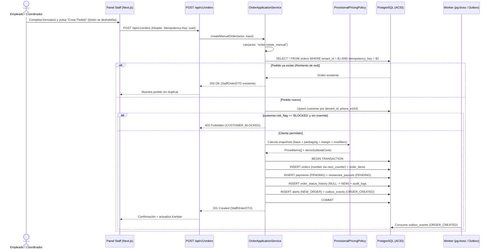
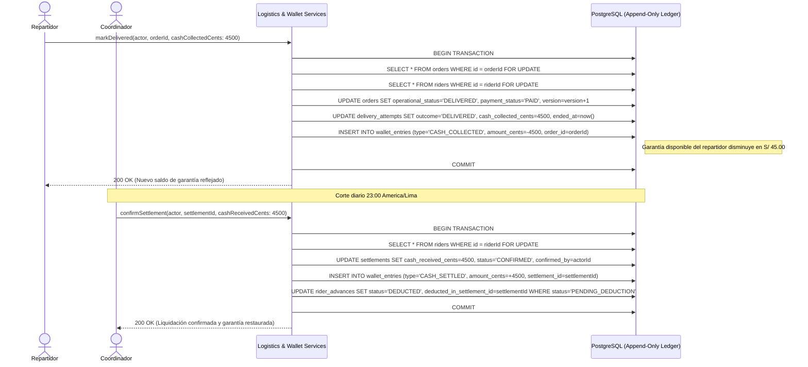
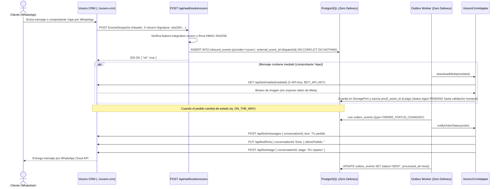

# 09 — Diagramas de Secuencia

> **Estado:** `[DESIGNED]` · **Versión:** 1.0-mvp · **Fuente:** `docs/ZERO_DELIVERY_MVP_BUILD_SPEC.md` + `02-casos-de-uso.md`

---

## 1. Registro Manual de Pedido con Idempotencia y Snapshot (CU-004)



---

## 2. Validación de Pago, Abono al Restaurante, Handoff y Regla de Liberación (CU-007, CU-008, CU-009)

```mermaid
sequenceDiagram
    actor Coord as Coordinador / Empleado
    actor Manager as Encargado (Sucursal)
    actor Rider as Repartidor (PWA)
    participant Svc as Orders & Payments Services
    participant Gate as evaluateReleaseGate()
    participant DB as PostgreSQL

    Note over Coord,DB: Pedido en estado READY con pago YAPE pendiente
    Coord->>Svc: validatePayment(actor, orderId)
    Svc->>DB: UPDATE payments SET status='PAID', validated_by=actor; INSERT payment_events
    Svc->>DB: UPDATE orders SET payment_status='PAID'

    Coord->>Svc: assignRider(actor, orderId, riderId)
    Svc->>Svc: canAssignRider(rider, order, guaranteeBalance)
    Svc->>DB: UPDATE orders SET operational_status='RIDER_ASSIGNED', rider_id=riderId

    Rider->>Svc: transition(RIDER_ASSIGNED -> RIDER_AT_PICKUP)
    Svc->>DB: UPDATE orders SET operational_status='RIDER_AT_PICKUP'

    alt Encargado intenta handoff ANTES de que el restaurante cobre
        Manager->>Svc: registerHandoff(actor, orderId)
        Svc-->>Manager: 409 Conflict (RESTAURANT_PAYOUT_NOT_CONFIRMED)
    end

    Coord->>Svc: confirmRestaurantPayout(actor, orderId, reference)
    Svc->>DB: UPDATE restaurant_payouts SET status='CONFIRMED'; UPDATE orders SET restaurant_payout_status='CONFIRMED'

    Manager->>Svc: registerHandoff(actor, orderId)
    Svc->>DB: UPDATE orders SET handoff_at=now(), handoff_by=managerId

    Rider->>Svc: transition(RIDER_AT_PICKUP -> ON_THE_WAY)
    Svc->>DB: SELECT * FROM orders WHERE id=orderId FOR UPDATE
    Svc->>Gate: evaluateReleaseGate(order, payment, payout, rider, handoff)
    Gate-->>Svc: { ok: true, failures: [] }
    Svc->>DB: UPDATE orders SET operational_status='ON_THE_WAY', released_at=now(), version=version+1
    Svc->>DB: INSERT delivery_attempts (attempt_no=1, outcome='IN_PROGRESS')
    Svc->>DB: INSERT order_status_history + audit_logs + outbox_events
    Svc-->>Rider: 200 OK (En camino al cliente)
```

---

## 3. Entrega en Efectivo, Libro Mayor de Garantía y Liquidación Diaria (CU-010, CU-012)



---

## 4. Integración Bidireccional con Vocero CRM (CU-015 / Punto de Extensión)


