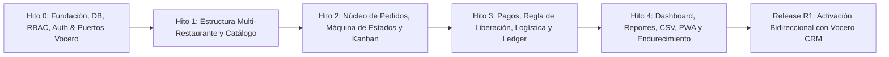

# Plan de Implementación por Fases — Zero Delivery

> **Generado con:** `software-architect` (Implementation Bridge) · **Fecha:** 2026-10-26

---

## Visión General de Fases (Hitos)

El proyecto se implementa en 5 hitos incrementales (Hito 0 a Hito 4) más la fase de activación en vivo con Vocero CRM (R1). Ningún hito comienza sin que el anterior tenga `typecheck`, `lint` y `test` en verde.

---

## Fase 0 (Hito 0): Fundación, Esquema Completo, RBAC, Auth e Infraestructura de Integración Vocero CRM

**Objetivo:** Dejar la estructura base completa funcionando, base de datos y migraciones listas con triggers append-only, dominio puro verificado (permisos `can()`, máquina de estados, `evaluateReleaseGate`, `canAssignRider`, `ProvisionalPricingPolicy`, contrato HMAC de Vocero CRM), autenticación por rol y navegación diferenciada.

| Tarea | Requerimientos / CU | Archivos Clave a Crear | Complejidad |
|---|---|---|---|
| **T0.1** Configuración del repositorio (`pnpm`, TS estricto, ESLint, Tailwind, Vitest, Playwright, Docker Compose) | RNF-008 | `package.json`, `tsconfig.json`, `eslint.config.mjs`, `docker-compose.yml`, `.env.example` | M |
| **T0.2** Utilidades transversales (`money` en céntimos, `time` en `America/Lima`, `phone` E.164 Perú, `errors`, `result`, `logger`, `i18n` `es-PE`) | RNF-004, RNF-007 | `src/shared/money.ts`, `src/shared/time.ts`, `src/shared/phone.ts`, `src/shared/errors.ts`, `src/shared/result.ts`, `src/shared/i18n/es-PE.ts` | M |
| **T0.3** Esquema PostgreSQL completo en Drizzle ORM + migración SQL con triggers `forbid_mutation()`, `orders_before_write()` y `seed_default_settings()` | RF-001..32, RNF-004, RNF-005 | `src/db/schema.ts`, `src/db/index.ts`, `drizzle/0000_initial_zero_delivery.sql`, `drizzle.config.ts` | L |
| **T0.4** Motor de autorización RBAC `can(actor, action, resource, settings)` con test table-driven exhaustivo | RF-001, CA-01, CU-001 | `src/modules/identity/domain/permissions.ts`, `tests/unit/permissions.test.ts` | M |
| **T0.5** Reglas de dominio críticas puras y sus suites de tests (`evaluateReleaseGate`, `canAssignRider`, `ORDER_TRANSITIONS`, `ProvisionalPricingPolicy`, `CustomerOrderDTO` vs `StaffOrderDTO`) | RF-004, RF-005, RF-019, RF-020, CA-03..12 | `src/modules/orders/domain/*`, `src/modules/logistics/domain/*`, `src/modules/catalog/domain/*`, `src/modules/wallet/domain/*` | L |
| **T0.6** Servicios de Configuración (`settings`), Auditoría (`audit`) y Autenticación (`login`/`logout`/sesiones/hash Argon2id) + rutas `/api/v1/auth/*` y `/api/v1/health` | RF-001, RF-031, CU-001 | `src/modules/settings/*`, `src/modules/audit/*`, `src/modules/identity/*`, `src/app/api/v1/auth/*` | M |
| **T0.7** Puertos de Integración y Adaptador `VoceroCrmAdapter` + Webhook `/api/webhooks/[provider]` con verificación `X-Vocero-Signature` (HMAC-SHA256 compatible con `vocero-crm`) + `/api/webhooks/vocero/health` | RF-023..27, CA-13, CU-015 | `src/modules/integrations/domain/ports.ts`, `src/modules/integrations/infra/vocero-crm.adapter.ts`, `src/app/api/webhooks/[provider]/route.ts`, `src/app/api/webhooks/vocero/health/route.ts` | M |
| **T0.8** Shell PWA (`manifest.webmanifest`, íconos, layout por rol `/(auth)/login`, `/(staff)`, `/(rider)`, `/(public)`) y script `scripts/seed.ts` | RNF-001, CU-001 | `src/app/manifest.ts`, `src/app/(auth)/login/page.tsx`, `src/app/(staff)/layout.tsx`, `src/app/(rider)/layout.tsx`, `scripts/seed.ts` | M |

---

## Fase 1 (Hito 1): Estructura Organizacional y Catálogo

| Tarea | Requerimientos / CU | Archivos Clave | Complejidad |
|---|---|---|---|
| **T1.1** CRUD de Usuarios y Asignación de Alcance de Sucursales (`user_branch_access`) | RF-001, CU-001 | `src/modules/identity/application/user.service.ts`, `src/app/api/v1/users/route.ts` | M |
| **T1.2** Gestión de Restaurantes, Sucursales, Horarios (`branch_schedules`), Toggle Manual y Zonas (`delivery_zones`) | RF-010, RF-011, CU-002 | `src/modules/tenancy/application/*`, `src/app/api/v1/branches/*` | M |
| **T1.3** Catálogo de Categorías, Productos (`is_fragile`, archivado sin borrado físico), Modificadores y Cartas por Sucursal (`menus`, `menu_items`) + `StoragePort` local | RF-008, RF-009, CU-003 | `src/modules/catalog/application/*`, `src/modules/integrations/infra/local-storage.adapter.ts` | L |

---

## Fase 2 (Hito 2): Pedidos, Máquina de Estados y Tablero Kanban

| Tarea | Requerimientos / CU | Archivos Clave | Complejidad |
|---|---|---|---|
| **T2.1** Gestión de Clientes con Deduplicación `E.164` y Filtro Manual `risk_flag` | RF-012, RF-013, CU-004 | `src/modules/customers/application/customer.service.ts` | M |
| **T2.2** Creación Manual de Pedidos con `Idempotency-Key`, Snapshots y `ProvisionalPricingPolicy` | RF-004, CA-12, CA-13, CU-004 | `src/modules/orders/application/create-order.service.ts`, `src/app/api/v1/orders/route.ts` | L |
| **T2.3** Ejecutor Transaccional de Máquina de Estados (`SELECT ... FOR UPDATE` + `version`) y Alertas de Timeout (`NEW_ORDER`, `ACCEPTANCE_TIMEOUT`) | RF-005, RF-029, CA-02, CU-005 | `src/modules/orders/application/transition-order.service.ts`, `src/worker/index.ts` | L |
| **T2.4** Manejo de Productos Faltantes (`UNAVAILABLE`), Solicitud/Autorización de Cancelación y Cambio de Dirección | CA-05, CU-006 | `src/modules/orders/application/order-exceptions.service.ts` | M |
| **T2.5** Tablero Kanban en Tiempo Real (`useLiveOrders` con polling ETag) y Vista Operativa de Sucursal | RF-028, RF-030, CU-005 | `src/modules/orders/ui/*`, `src/app/(staff)/orders/page.tsx` | L |

---

## Fase 3 (Hito 3): Pagos, Regla de Liberación, Logística y Finanzas del Repartidor

| Tarea | Requerimientos / CU | Archivos Clave | Complejidad |
|---|---|---|---|
| **T3.1** Validación Humana de Pagos, Pago al Restaurante (`restaurant_payouts`), Correcciones (`payment_events`) y Reembolsos | RF-019, CA-03, CA-11, CU-007 | `src/modules/payments/application/*`, `src/app/api/v1/orders/[orderId]/payment/*` | M |
| **T3.2** Handoff Físico en Sucursal y Guarda de Despacho (`evaluateReleaseGate`) | RF-019, CA-04, CU-009 | `src/modules/orders/application/release-order.service.ts` | M |
| **T3.3** Perfiles de Repartidor, Asignación Manual con `canAssignRider()`, Vista Móvil PWA, Ping Manual de Ubicación y Entregas Fallidas/Devoluciones | RF-006, RF-007, CA-06..08, CU-008..11 | `src/modules/logistics/application/*`, `src/app/(rider)/*` | L |
| **T3.4** Libro Mayor (`wallet_entries`), Bloqueo por Deuda/Garantía, Adelantos (`rider_advances`) y Liquidación Diaria con Corte 23:00 (`settlements`) | RF-020, CA-09, CA-10, CU-012 | `src/modules/wallet/application/*`, `src/app/api/v1/settlements/*` | L |

---

## Fase 4 (Hito 4): Dashboard, Reportes, Exportación CSV, Menú Público y Endurecimiento

| Tarea | Requerimientos / CU | Archivos Clave | Complejidad |
|---|---|---|---|
| **T4.1** Dashboard por Rol y Periodos (`America/Lima`) + Reportes `RF-15` (Ventas), `RF-16` (Operativo), `RF-17` (Clientes) | RF-002, RF-015..17, CU-013 | `src/modules/reporting/application/*` | L |
| **T4.2** Exportador CSV en Streaming (UTF-8 con BOM) respetando permisos de lectura | RF-032, CA-14, CU-013 | `src/modules/reporting/infra/csv-exporter.ts` | M |
| **T4.3** Menú Público `/m/[branchSlug]`, Estado de Pedido `/p/[publicToken]` y Captura de Embudo (`funnel_events`) | RF-018, CA-12, CU-014 | `src/app/(public)/m/[branchSlug]/page.tsx`, `src/app/(public)/p/[publicToken]/page.tsx` | M |
| **T4.4** Scripts de Backup/Restore probados y Suite E2E Playwright del camino feliz | RNF-009, CA-15 | `scripts/backup.sh`, `scripts/restore.sh`, `tests/e2e/*` | M |
